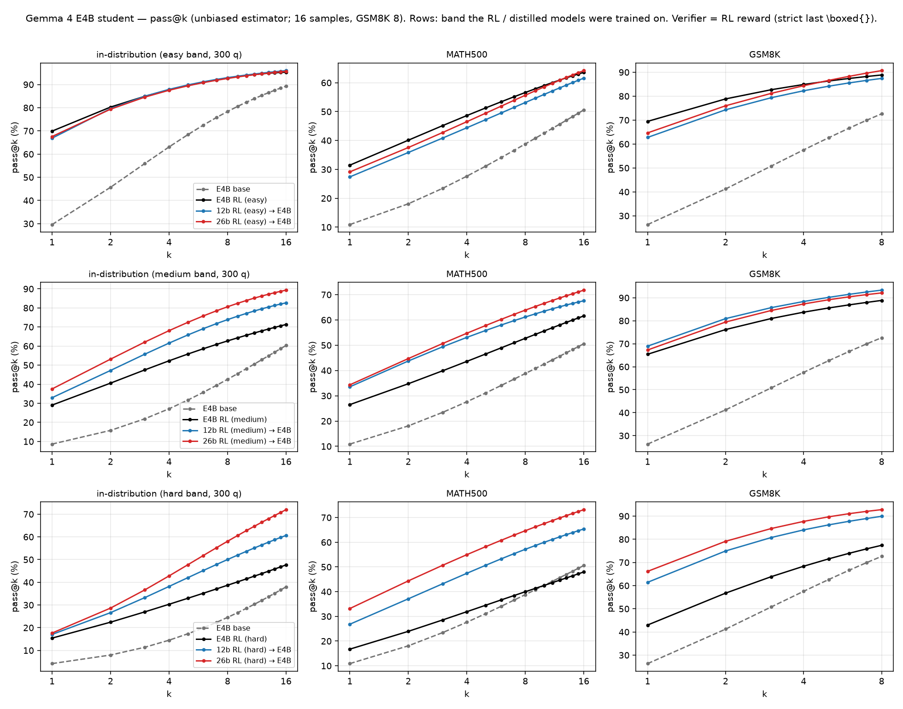
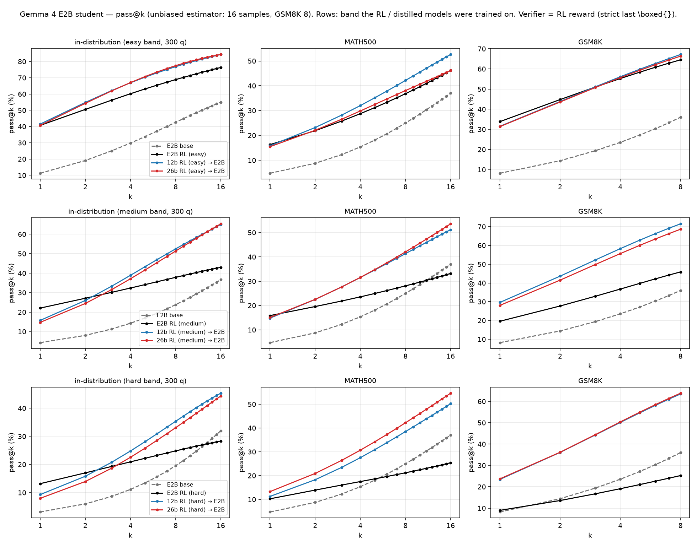
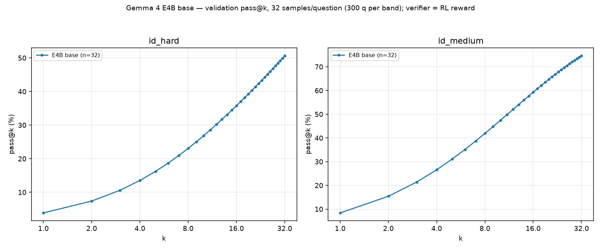
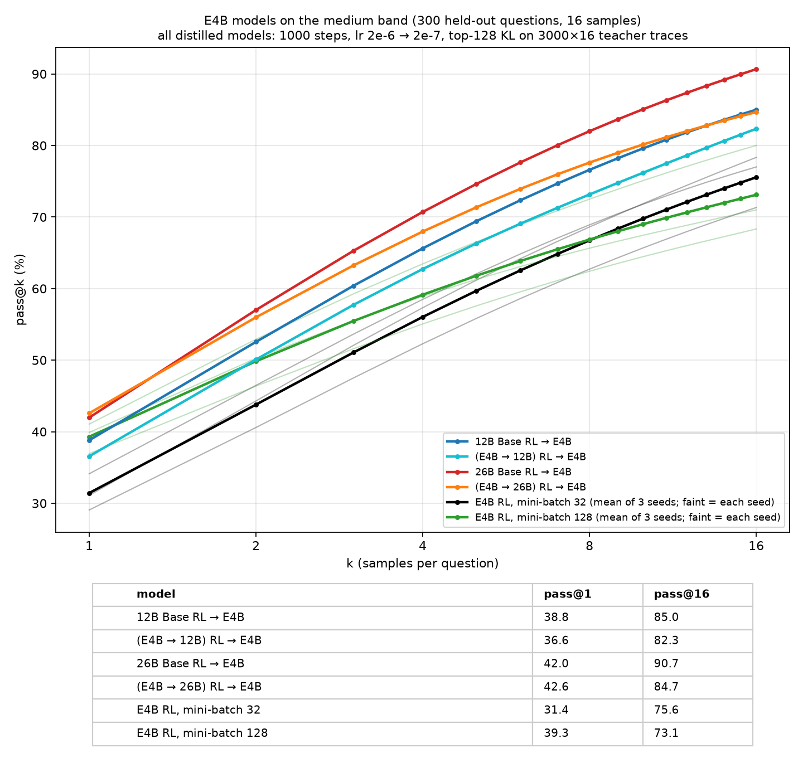

# Gemma 4 results: RL vs. distillation (E2B / E4B / 12B)

Last updated: 2026-10-26

This is the single results document for every Gemma 4 experiment in this repo. It consolidates the former
`GEMMA4_DISTILL_VS_RL_EXPERIMENTS.md`, `DISTILLATION_EXPERIMENTS.md` (§1–§9.1), `GEMMA4_RL_DISTILL_BASE_EVALS.md`,
`GEMMA4_THREE_MODEL_EVALS.md`, `GEMMA4_DIFFICULTY_RL_RUNS.md`, `DEEPSCALER_GEMMA4_PT_PASS_RATES.md` and the Gemma 4
entries of [`../PROGRESS_LOG.md`](../PROGRESS_LOG.md) (all of them are in git history). How to run the recipes is in
[`RECIPES.md`](RECIPES.md); cluster / supervisor / checkpoint mechanics are in [`OPERATIONS.md`](OPERATIONS.md); the
Qwen3 counterpart is [`QWEN3_RESULTS.md`](QWEN3_RESULTS.md).

Scope: Gemma 4 **E2B, E4B, 12B** (all `google/gemma-4-*` PT checkpoints) on H100, with (1) DAPO/GRPO RL,
(2) off-policy top-128 forward-KL distillation, and (3) on-policy distillation. Gemma 4 **26B-A4B** appears only as the
model that defines the difficulty bands, as an RL teacher in the distillation grid, and as a control student; its own
RL runs are summarized in one line each. Gemma 3 work (including the Gemma 3 on-policy runs) is archived in git history.

Contents

1. [Summary of findings](#1-summary-of-findings)
2. [Setup](#2-setup)
3. [RL results](#3-rl-results)
4. [Off-policy top-k distillation results](#4-off-policy-top-k-distillation-results)
5. [On-policy distillation (reverse-KL top-k, retired recipe)](#5-on-policy-distillation-reverse-kl-top-k-retired-recipe)
6. [Full evaluation matrix](#6-full-evaluation-matrix)
7. [Earlier pilot studies (July–August 2026, superseded splits)](#7-earlier-pilot-studies-julyaugust-2026-superseded-splits)
8. [Artifact index](#8-artifact-index)

---

## 1. Summary of findings

Numbers are `mean@16 / pass@16` (%) on the 300-question in-distribution (ID) validation split of the model's band
unless noted (§2.4). RL-logged validation numbers are `val-core/math/acc/mean@16` as fractions.

- **Distilling a bigger RL teacher beats direct RL for the E4B student on medium/hard, and gains grow with k.**
  Medium: 12B-teacher student 32.9 / 82.7, 26B-teacher student 37.5 / 89.3 vs E4B RL 29.1 / 71.3 (base 8.6 / 60.3).
  Hard: 12B → E4B 17.0 / 60.7, 26B → E4B 17.6 / 72.0 vs E4B RL 15.4 / 47.7. On easy all trained E4B models tie
  (66.9–69.9 mean@16). Self-distillation (E4B RL → E4B base) reproduces the RL teacher (medium 28.5 / 75.7, hard
  15.2 / 46.7).
- **For the E2B student, RL and distillation trade off.** RL wins single-sample accuracy on medium/hard (medium RL
  22.1 vs 12B/26B/E4B teachers 15.8 / 14.7 / 14.0) but every bigger teacher raises pass@16 by ~20 points (medium 43.0
  RL vs 65.0 / 65.3 / 62.3) and transfers far better to MATH500/GSM8K. E2B self-distillation ≈ E2B RL (21.7 / 42.3).
- **Teacher quality orders the E4B student, but teacher lineage sets sharpness vs. coverage.** With the 3,000×16-trace /
  1000-step / 2e-6 recipe on medium: teacher val 0.444 → student 33.0, 0.497 → 36.6, 0.527 → 38.8 (12B teachers);
  26B teachers give 42.6 / 84.7 (distilled-lineage, val 0.638) and 42.0 / **90.7** (untrained lineage, val 0.694).
  Final validation KL is *not* a cross-teacher predictor (lowest KL 0.0836 came with the weakest student).
- **RL batch size: 4× batch (256 prompts) sharpens E4B RL.** Best val 0.395 (3-seed mean) vs 0.319 at 64 prompts;
  math mean@k +4 to +8 on every set, pass@k −2 to −6. The best 4× seed (41.1 id_medium) matches distilled students on
  mean@k but not on pass@k (80.0 vs 84.7–90.7).
- **Pre-training control: distilling the *untrained* E4B base into 12B/26B pulls the big students down onto the
  teacher's pass@k curve** within 100–200 steps and never above it (12B step 1000: pass@1/32 8.1 / 73.0 vs teacher
  8.4 / 74.7; untrained 12B 14.1 / 86.3). RL on that distilled 12B reaches 0.497 val (untrained-12B RL: 0.527).
- **Distilling the RL'd distilled-12B back into E4B** gives a sharper E4B student than the untrained-12B teacher of the
  same generation (medium 36.6 vs 32.9 mean@16, pass@16 82.3 vs 82.7; the control used the earlier 8-sample /
  500-step recipe).
- **On-policy distillation with truncated reverse KL is fragile.** Teacher-support top-128 rKL collapsed by step 100
  (mass leaked outside the teacher's support; val 0.078 → 0.031). Student-support top-128 rKL helped for ~100 steps
  (step 50: rKL 0.0885 → 0.0713, pass@k above the teacher) then flattened; adding a tail bucket fixed the drift for 200
  steps but validation plateaued at teacher level (~0.10). RL from the on-policy student starts faster but plateaus
  lower (0.444 vs 0.497). This recipe is no longer used; current on-policy work uses PG-k1 (see `RECIPES.md`).
- **Metric caveat:** verl's RL-logged `best@16` is a with-replacement bootstrap ≈ pass@10 and must never be compared
  with offline pass@k (§2.5).

## 2. Setup

### 2.1 Models (pinned revisions)

| Model | Revision | Notes |
|---|---|---|
| `google/gemma-4-E2B` | `d29ff6b45f081a49ee2733a859c9c9c2d95d1a6f` | FSDP wrap `Gemma4TextDecoderLayer` |
| `google/gemma-4-E4B` | `411aa17b749aa952df1359d2dcea73917a544d9a` | FSDP wrap `Gemma4TextDecoderLayer` |
| `google/gemma-4-12B` | `023679ed352de9bb66cc873c9009ce3482585c08` | `Gemma4UnifiedForConditionalGeneration`; wrap `Gemma4UnifiedTextDecoderLayer` |
| `google/gemma-4-26B-A4B` | `24548b62aa021d562695c04aaf7758a1ea47990b` | band definer / teacher / control student only |

All four share one tokenizer fingerprint (262,144 tokens), which the top-k KL preflight requires. 12B actor exports
lack `processor_config.json`; it is copied from the base model before vLLM loads them (see §2.6).

### 2.2 Prompt and sampling

- Prompt: the 12-shot raw-completion template `data/gemma3_it_fewshot_math.jinja` (SHA256 `27b8801d…63c1c`). Despite
  the name it is *the* Gemma 4 prompt for RL, trace generation and evaluation: 4 Minerva/MATH + 8 GSM8K exemplars
  normalized to `\boxed{}`, the question as the final user turn with `Please output the final answer within \boxed{}.`
  Rendered with `add_generation_prompt=True`, encoded with `add_special_tokens=False` (the template emits the BOS).
- Sampling everywhere (RL rollout, traces, eval): temperature 1.0, top-p 1.0, top-k −1, 4,096-token prompt cap,
  8,192-token response cap, 12,288 context. Gemma 4 has no `<end_of_turn>` token id: stop on the strings
  `<end_of_turn>` / `<start_of_turn>` (a sampler without them rambles to the cap — this invalidated the first
  reverse-KL measurements, §4.5).
- Reward / grader: boxed-only `math_verify` (`verl/utils/reward_score/math_verify.py`): only the last well-formed
  `\boxed{}`/`\fbox{}` is graded, correct if `math_verify` or the bounded Miles SymPy fallback accepts it
  (30 s verify, 5 s SymPy). Offline evals use exactly this function.

### 2.3 Difficulty bands (`gemma4_26b_bands`)

Source pool: DeepScaleR `dedup_v2` (38,796 questions), each sampled 8× (temp 1, 4,096-token cap, same 12-shot prompt)
by Gemma 4 E4B / 12B / 26B-A4B PT. Bands are defined by **Gemma 4 26B-A4B PT's** per-question score under the RL grader:

| Band | 26B-A4B PT correct out of 8 | Full-pool size | Released split |
|---|---|---:|---|
| easy | 4–8 | 3,314 | 3,000 train + 300 val |
| medium | 2–3 | 3,498 | 3,000 train + 300 val |
| hard | 1 | 5,342 | 3,000 train + 300 val |

Dataset: `JWei05/DeepScaleR-Easy-Medium-Hard-Gemma-26B-PT-10k@a0ba3c3dc07c7bc27e901670ceb1a0b0ceeaa8db`
(built by `data/build_deepscaler_gemma4_26b_difficulty_dataset.py`, which exists only untracked in the main
checkout `/mnt/efs/jasonwei/rl-distill`; selection and val assignment by stable SHA-256 rank; prepared for verl by
`data/prepare_deepscaler_gemma4_26b_difficulty_rl_data.py`, which repeats each val question 16×). The Qwen3-30B band
dataset is a replica of this construction (see `QWEN3_RESULTS.md`).

Pool pass rates that motivated the bands (n = 8, 38,796 questions, 4,096-token cap; strict = exactly one well-formed box):

| Model | lenient mean acc | strict mean acc | lenient pass@8 | strict pass@8 | strict 0/8 share |
|---|---:|---:|---:|---:|---:|
| E4B PT | 4.54 | 3.97 | 18.45 | 16.65 | 83.3 % |
| 12B PT | 6.64 | 6.17 | 23.34 | 21.95 | 78.0 % |
| 26B-A4B PT | 10.45 | 9.45 | 31.50 | 29.38 | 70.6 % |

(Pooled E4B+12B 16 attempts: strict pass@16 27.8 %. Raw per-question parquets and the combined audit live under
`/mnt/efs/jasonwei/verl/data/deepscaler_gemma4_*_pt8_dedup_v2_2026081{6,7}/`.) Cross-family overlap (2026-10-19,
`analysis/compare_gemma_qwen_band_overlap.py`): Qwen3-30B-A3B-Base solves far more of the pool (mean pass rate 0.339 vs
0.104); Gemma hard maps 46 % to Qwen easy, 27 % medium, 14 % hard.

### 2.4 Evaluation protocol

Offline math suite (protocol `gemma4_rl_distill_math_eval_v2`; `eval/eval_math_passk.py`, queue
`scale_train/gemma4/run_gemma4_distill_study_eval_queue.sh`, per model
`scale_train/gemma4/run_gemma4_rl_distill_eval_one_model.sh`, registry `config/gemma4_distill_study_eval_sources.json`):

| Family | Sets | Samples | Metrics |
|---|---|---:|---|
| ID | `id_easy`, `id_medium`, `id_hard` = the pinned 300-q band val splits (every model runs all three; own band = ID, others = cross-band transfer) | 16 | mean@16, pass@16, maj@16 |
| OOD math | MATH500 (`HuggingFaceH4/MATH-500@6e4ed1a2`), GSM8K test (`openai/gsm8k@740312ad`) | 16 / 8 | mean@k, pass@k |
| Out-of-domain | MMLU-Pro 5-shot CoT (12,032), GPQA-Diamond 5-shot CoT (198), MMMLU-14k (14 locales × 1,003) | — | accuracy via pinned lm-eval `f4d4b3de` (`eval/eval_gemma4_ood.py`) |

- pass@k is the unbiased estimator `1 − C(n−c,k)/C(n,k)` (`eval/gemma4_eval_metrics.py`); mean@k is the mean over all
  samples; maj@k uses semantic answer classes (bidirectional `math_verify`), invalid = abstain, ties wrong. Per-request
  seeds derive from (dataset, question id, sample index), so results do not depend on batching.
- ×32 variant `gemma4_rl_distill_math_eval_v2_x32` (id_medium / id_hard at 32 samples) for pass@k curves k = 1..32
  (`eval/eval_student_checkpoints_passk.py`, plots `analysis/plot_passk_from_traces.py`).
- Generation runs without logprobs (`EVAL_PREDICTIVE_TOPK_WIDTH=0`; ~6× faster; mean@16 40.42 vs 40.35 with logprobs).
- Pipeline check: offline `rl_e2b_easy` on id_easy gave mean@16 40.8 vs its W&B val best 41.0; every RL model's
  own-band offline mean@16 matched W&B within ~1 point.
- **Never compare the math family (repo boxed scorer) with OOD (lm-eval harness scorer), nor protocol v2 (300-q bands)
  with the August protocol (500-q Easy-10k/Medium-20k splits, §7).**

### 2.5 Metric caveats

- **verl `best@N` ≠ pass@N.** `verl/trainer/ppo/metric_utils.py::bootstrap_metric` draws N of the N responses *with
  replacement*; a question with c correct contributes `1 − (1 − c/N)^N` (one hit of 16 counts 0.64). With N = 16 this
  behaves like pass@10. Observed: the on-policy step-50 student logged best@16 = 0.501 while offline pass@16 = 61.9
  (pass@8 44.9); mean@16 (0.097) matched offline pass@1 (9.6). Use RL-logged best@N only within/across RL logs.
- RL-logged validation has ±0.5–1 pt sampling noise between adjacent checkpoints; a re-sampled validation of the same
  step moved 0.313 → 0.3175 (E4B seed 43).
- Validation comparisons across batch sizes must be by prompts consumed, not steps.

### 2.6 Invalidated data: v1 best-checkpoint traces (September 2026)

The first collection of RL-teacher traces (`gemma4-bestckpt-traces-topk128-v1`, 2026-09-03/04) loaded teachers in vLLM
through `hf_overrides={"architectures":["Gemma4ForCausalLM"]}` to dodge the 12B exports' missing
`processor_config.json`. That load mis-maps the multimodal rows of the LM head: their logits inflate (a multimodal id
in the top-5 at ~34 % of positions vs 2/1076 for the correct load), top-k logprobs of real tokens are deflated by up
to 6.5 nats, and `<image|>` leaked into 71.6 % of sampled responses (strict-correct 0.165 vs 0.924 for the clean load).
Greedy argmax is unaffected, so greedy spot-checks miss it. v1 was deleted; every trace in this document is **v2**
(native unified architecture + the base model's byte-compatible `processor_config.json`; 0 % multimodal leakage,
0 % length-cap runaways). Rule: never override the Gemma 4 architecture in vLLM.

## 3. RL results

### 3.1 Recipe (difficulty sweep, seed 42)

`scale_train/run_gemma4_pt_deepscaler_4of4strict_rl.sh` → `run_dapo_rl.sh` (launchers in `scale_train/gemma4/`;
details in `RECIPES.md`). GRPO n = 16, 64 prompts / PPO mini-batch 32, token-mean loss, lr 1e-6 (20 warmup), AdamW wd
0.1, 4k prompt / 8k response with a 2k soft overlong buffer, always-on token TIS (cap 2.0), validation every 10 steps
on 300 q × 16, early stopping on val mean@16 (E2B/E4B patience 5; 12B/26B patience 1, raised to 2 on 2026-08-31),
400-step cap, FSDP2 DP8, `sp_size=1`, no remove-padding. W&B project `rl-distill/DAPO`, run ids
`g4ds26b-<size>-<band>-s42-v1`.

### 3.2 Best checkpoint per (model, band)

| Model | Band | Best step | val mean@16 | HF export (`repo@commit/step_NNNNNN`) |
|---|---|---:|---:|---|
| E2B | easy | 130 | 0.4102 | `JWei05/DAPO-gemma4-e2b-PT-DeepScaleR-gemma26b-easy-seed42-local2gpu@c82460136fb1` |
| E2B | medium | 240 | 0.2250 | `JWei05/DAPO-gemma4-e2b-PT-DeepScaleR-gemma26b-medium-seed42-local2gpu@497e7964f98b` (pinned while still training) |
| E2B | hard | 190 | 0.1363 | `JWei05/DAPO-gemma4-e2b-PT-DeepScaleR-gemma26b-hard-seed42-local2gpu@59762d43bf94` |
| E4B | easy | 100 | 0.7056 | `JWei05/DAPO-gemma4-e4b-PT-DeepScaleR-gemma26b-easy-seed42-26b-bands-es5@345beec132e3` |
| E4B | medium | 90 | 0.2998 | `JWei05/DAPO-gemma4-e4b-PT-DeepScaleR-gemma26b-medium-seed42-26b-bands-es5@5f90d25e193d` |
| E4B | hard | 120 | 0.1590 | `JWei05/DAPO-gemma4-e4b-PT-DeepScaleR-gemma26b-hard-seed42-26b-bands-es5@627bd9d825ff` |
| 12B | easy | 70 | 0.8408 | `JWei05/DAPO-gemma4-12b-PT-DeepScaleR-gemma26b-easy-seed42-26b-bands-es5@372aa8417b09` |
| 12B | medium | 120 (→ 140 after resume, §3.4) | 0.5208 (→ 0.5271) | `JWei05/DAPO-gemma4-12b-PT-DeepScaleR-gemma26b-medium-seed42-26b-bands-es5@485326ce84d0` |
| 12B | hard | 140 (stopped 160) | 0.2767 | `JWei05/DAPO-gemma4-12b-PT-DeepScaleR-gemma26b-hard-seed42-26b-bands-es5@162d85023909` |
| 26B-A4B | easy | 80 | 0.9408 | `JWei05/DAPO-gemma4-26b-a4b-PT-DeepScaleR-gemma26b-easy-seed42-26b-bands-es5@f72b7fc8af90` |
| 26B-A4B | medium | 140 | 0.6725 | `JWei05/DAPO-gemma4-26b-a4b-PT-DeepScaleR-gemma26b-medium-seed42-26b-bands-es5@4da4c943785f` |
| 26B-A4B | hard | 180 | 0.4329 | `JWei05/DAPO-gemma4-26b-a4b-PT-DeepScaleR-gemma26b-hard-seed42@7659c94add2a` |

E2B and the 26B medium/hard values are the W&B peaks at pin time (2026-09-04) while those runs were still training
off-cluster; the pinned exports are what every downstream trace and eval used. E4B/12B/26B-easy full checkpoints
(model + Adam + `data.pt` + `validation_early_stopping.json`) are under
`s3://scale-ml/genai/rl-distill/gemma4-difficulty-s42-20260819-full-checkpoints/<run>/`, best-HF under
`…/gemma4-difficulty-s42-20260819/`. Offline math for the six E2B/E4B RL models is in §6.

### 3.3 Seeds (E4B medium) and 4× batch

64-prompt recipe, seeds 42–44 (seeds 43/44: 4 GPUs, `scale_train/gemma4/launch_gemma4_rl_band_seed.sh`, S3
`gemma4-difficulty-s4{3,4}-20260910{,-full-checkpoints}/e4b-medium`, best-HF `…/gemma4-e4b-medium/best_hf/`, W&B
`g4ds26b-e4b-medium-s4{3,4}-v1`):

| seed | best val | best step | stop step | note |
|---|---:|---:|---:|---|
| 42 | 0.2998 | 90 | — | §3.2 (one later table in the old doc listed 0.340 for seed 42; the per-run record and the 3-seed summary use 0.300) |
| 43 | 0.3175 | 120 | 170 | best is a re-sampled step-120 validation after a preemption (first sample 0.313) |
| 44 | 0.3404 | 160 | 210 | 0.087 @0, 0.224 @30, 0.30 @60 |

4× batch, seeds 45–47 (`TRAIN_PROMPT_BSZ=256 TRAIN_PROMPT_MINI_BSZ=128`, update layout mbs 8 / 16,384 tokens,
`VERL_GEMMA4_CUDNN_SDPA=0`, 4 GPUs, ~12 min/step; S3 `gemma4-e4b-bs256-s<seed>-20260919{,-full-checkpoints}/e4b-medium`,
W&B `g4ds26b-e4b-medium-s4{5,6,7}-bs256-v1`):

| step (prompts seen) | 0 | 10 (2.6k) | 20 | 30 | 40 | 50 (12.8k) | 60 | 70 | 80 | 90 | 100 (25.6k) |
|---|---|---|---|---|---|---|---|---|---|---|---|
| seed 45 | 0.091 | 0.098 | 0.172 | 0.256 | 0.297 | 0.318 | 0.334 | 0.350 | 0.375 | 0.361 | **0.378** |
| seed 46 | 0.083 | 0.098 | 0.194 | 0.260 | 0.297 | 0.326 | 0.360 | 0.368 | 0.371 | 0.394 | **0.404** |
| seed 47 | 0.086 | 0.099 | 0.203 | 0.265 | 0.300 | 0.316 | 0.346 | 0.348 | 0.368 | 0.382 | 0.396 |

Final: seed 45 best 0.378 @100 (stop 150), seed 46 0.404 @100 (stop 150), seed 47 **0.404 @130** (stop 180) → mean
0.395 (sd 0.015) vs 0.319 for seeds 42–44 (+7.6 pts), ~35–45 h each.

Math suite (mean@k / pass@k; k = 16, GSM8K k = 8):

| model | id_easy | id_medium (own) | id_hard | MATH500 | GSM8K |
|---|---|---|---|---|---|
| seed 42 (step 90) | 62.2 / 94.3 | 29.1 / 71.3 | 17.2 / 58.3 | 26.5 / 61.6 | 65.4 / 88.9 |
| seed 43 (step 120) | 66.8 / 96.7 | 31.1 / 78.3 | 17.7 / 60.0 | 28.1 / 64.2 | 64.7 / 90.4 |
| seed 44 (step 160) | 66.5 / 95.3 | 34.1 / 77.0 | 19.8 / 60.7 | 29.4 / 60.6 | 67.7 / 91.6 |
| **64-prompt mean** | 65.2 / 95.4 | 31.4 / 75.5 | 18.2 / 59.7 | 28.0 / 62.1 | 65.9 / 90.3 |
| 4× seed 45 (step 100) | 70.4 / 89.3 | 36.9 / 68.3 | 22.5 / 53.3 | 30.8 / 55.0 | 72.8 / 86.8 |
| 4× seed 46 (step 100) | 72.4 / 92.0 | 39.9 / 71.0 | 20.7 / 52.3 | 31.2 / 56.4 | 72.7 / 88.7 |
| 4× seed 47 (step 130) | 73.9 / 94.3 | **41.1 / 80.0** | 22.9 / 56.7 | 34.6 / 62.8 | 73.0 / 90.7 |
| **4× mean (sd)** | 72.2 (1.8) / 91.9 (2.5) | 39.3 (2.2) / 73.1 (6.1) | 22.0 (1.2) / 54.1 (2.3) | 32.2 (2.1) / 58.1 (4.2) | 72.8 (0.2) / 88.7 (2.0) |

4× vs 64-prompt: mean@k +7.0 / +7.9 / +3.9 / +4.2 / +6.9, pass@k −3.5 / −2.4 / −5.6 / −4.0 / −1.6. The later-peaking
seed 47 loses the least coverage. For a teacher (single-sample accuracy) the 4× batch is better; for pass@k / trace
diversity the 64-prompt runs keep 2–6 more points.

Train-set fit (2026-10-09; 300 text-deduplicated questions sampled from the medium *train* split, same protocol,
`eval/local/run_gemma4_train_sample_eval_local.sh`, results `s3://…/gemma4-train-sample-evals-v1/train_medium/<tag>/`):

| model | train sample avg@16 / pass@16 | medium val | train − val |
|---|---|---|---|
| E4B RL seed 43 (step 120) | 32.4 / 80.7 | 31.1 / 78.3 | +1.3 / +2.4 |
| E4B RL 4× seed 46 (step 100) | 57.6 / 81.0 | 39.9 / 71.0 | +17.7 / +10.0 |
| 12br → E4B (step 1000) | 46.9 / 89.0 | 38.8 / 85.0 | +8.1 / +4.0 |
| 12bd → E4B (step 1000) | 53.5 / 87.7 | 36.6 / 82.3 | +16.9 / +5.4 |
| 26bw → E4B (step 1000, `-n8`) | 53.1 / **92.0** | 42.0 / 90.7 | +11.1 / +1.3 |
| 26bd → E4B (step 1000) | **65.4** / 89.7 | 42.6 / 85.3 | +22.8 / +4.4 |

(The 26bd val pass@16 is 85.3 in this table and 84.7 in the suite row of §6; both are as recorded.) The 64-prompt run
(~2.6 passes over the band) barely separates train from val; the 4× run (~8.5 passes) and every distilled student
fit train questions much more, most for the distilled-lineage teachers.

Seed-43 runs of E2B easy/medium/hard and E4B easy/hard were started 2026-09-10 and paused at the user's request
before finishing (best-so-far: E2B easy 0.396 @160, E2B medium 0.145 @130, E4B easy 0.596 @20; resume points in
`gemma4-difficulty-s43-20260910-full-checkpoints/`). They are not results.

### 3.4 12B medium resume (patience 4)

The seed-42 12B medium run had stopped on patience 1 at step 130 (best 0.5208 @120, 0.5188 @130). It was resumed from
the step-130 full checkpoint (resharded 8 → 4 ranks bit-exactly with `utils/reshard_fsdp2_checkpoint.py`) with
patience 4 and the fast update layout (mbs 4 / 8,192 tokens, phase offload + vLLM sleep), 4 GPUs, job
`job_dakvn1pt1s0g07hmc3dg`, same W&B id `g4ds26b-12b-medium-s42-v1`:

| step | 140 | 150 | 160 | 170 | 180 |
|---|---|---|---|---|---|
| val mean@16 | **0.5271** | 0.511 | 0.519 | 0.519 | 0.513 (stop) |

Best moved 0.5208 @120 → **0.5271 @140** (within run-to-run noise). 4-rank checkpoints:
`s3://…/gemma4-difficulty-s42-20260819-full-checkpoints/12b-medium-local4/`; best-HF
`…/gemma4-difficulty-s42-20260819/gemma4-12b-medium-local4/best_hf/` (step 140 is S3-only). The 21-run grid (§4.2)
used the step-120 teacher; the `12br` teacher (§4.4) is step 140.

### 3.5 RL from distilled initializations (12B, medium)

Same DAPO medium recipe (lr 1e-6, 64 × 16, patience 5, cap 400):

| init | best val | best step | stop | trajectory | artifacts |
|---|---:|---:|---:|---|---|
| untrained 12B base (§3.2/§3.4) | 0.5271 | 140 | 180 | — | above |
| 12B distilled off-policy from E4B base (§4.3, step 1000 @ `92368d1f`) | **0.497** | 190 | 240 | 0.08 @0 → 0.306 @40 → 0.340 @50 → 0.456 @130 → 0.497 @190; 0.485–0.489 for 200–240 | best-HF `s3://…/gemma4-12b-from-e4bbase-distill-rl/gemma4-12b-medium-from-e4bbase-distill-es5/best_hf/`; ckpts `…-rl-full-checkpoints/12b-medium-from-e4bbase-distill-es5/` (every 10, 10–240); HF `JWei05/DAPO-gemma4-12b-PT-DeepScaleR-gemma26b-medium-seed42-from-e4bbase-distill-es5` (steps 170–240); W&B `g4ds26b-12b-medium-from-e4bbase-distill-es5-s42-v1` |
| 12B on-policy tail-bucket student, step 50 (§5.3) | 0.444 | 100 | 150 → resumed with patience 10 → 200 | table below | best-HF `s3://…/gemma4-12b-from-onpolicy-bkt50-rl/gemma4-12b-medium-from-onpolicy-bkt50-es5/best_hf/`; ckpts `…-rl-full-checkpoints/12b-medium-from-onpolicy-bkt50-es5/`; W&B `g4ds26b-12b-medium-from-onpolicy-bkt50-es5-s42-v1`; jobs `job_dalg97jns19g0896pnrg`, `job_dam2f37n0ur007idqui0` |

| step | 0 | 10 | 20 | 30 | 40 | 50 | 60 | 70 | 80 | 90 | 100 | 110 | 120 | 130 | 140 | 150 | 160–200 |
|---|---|---|---|---|---|---|---|---|---|---|---|---|---|---|---|---|---|
| from on-policy step 50 | 0.097 | 0.091 | 0.145 | 0.242 | 0.307 | 0.356 | 0.395 | 0.418 | 0.414 | 0.431 | **0.444** | 0.442 | 0.443 | 0.426 | 0.423 | 0.412 | 0.421 / 0.423 / 0.430 / 0.420 / 0.428 |
| from off-policy step 1000 | 0.10 | 0.09 | 0.13 | ~0.20 | ~0.27 | ~0.31 | ~0.34 | ~0.37 | — | ~0.40 | ~0.42 | — | ~0.45 | — | — | — | → 0.497 @190 |

The on-policy-distilled student learns faster for 100 steps (+4–5 pts) but plateaus at ~0.44; the lower reverse KL at
init bought a faster start, not a higher ceiling. RL-logged mean@16 / best@16 of that run: 0 → 0.097 / 0.501,
50 → 0.356 / 0.802, 100 → 0.444 / 0.808, 150 → 0.413 / 0.739, 200 → 0.429 / 0.745.

26B-A4B RL (one line each; used only as distillation teachers in §4.4): untrained 26B medium 0.6725 @140 (crashed at
146; a weight-only warm start from step 140 reached **0.694 @ original step 170** = teacher `26bw`); RL on the
E4B-base-distilled 26B student reached **0.638 @250** (stopped at a 5-h deadline, step 280) = teacher `26bd`.

### 3.6 Engineering findings that affect RL numbers

- cuDNN SDPA: the engine forces cuDNN SDPA on for Gemma 4 train forwards unless `VERL_GEMMA4_CUDNN_SDPA=0`. On E4B RL
  it is a bottleneck (per-shape plan compilation: old-logprob 65 s vs 15 s, first update pass 192 s vs 64 s per
  128-sequence step) and caused `mha_graph.execute` / `CUDNN_STATUS_INTERNAL_ERROR` crashes → set 0 for E4B
  (seeds 45–47 onward). On 26B-A4B it is ~7 % faster (118 vs 125–129 s update) → keep 1. Seeds 43/44 trained with
  cuDNN on throughout. Largest safe E4B update layout: 8 × 16,384 tokens (56.8 GiB).
- Fast 12B/E4B update layout (mbs 4 / 8,192 cap, phase offload, vLLM sleep) is gradient-neutral under the global
  token-mean loss; it cut E4B step time ~6.5× (update 1450 → 156 s).

## 4. Off-policy top-k distillation results

Objective: top-128 forward KL on teacher-sampled traces, Σ over the teacher's top-128 of p_t (log p_t − log q_s),
response tokens only (`main_full_vocab_distill_fsdp2.py` via `gemma4_topk_distill_fsdp2.sh` /
`scale_train/run_gemma4_distill_one.sh`; traces from `scale_train/run_gemma4_bestckpt_trace_collection.sh` →
`data/generate_gemma4_distill_traces.py`). Teacher traces store the top-128 ids + full-vocab-normalized logprobs per
position (from vLLM), the sampled token, exact ids and response mask; the student never re-tokenizes. The
"tail bucket" variant (adds the (k+1)-th bucket {rest}) is the off-policy recipe documented in `RECIPES.md`; the Gemma 4
runs below used the plain top-128 sum. Two recipe versions:

| | v2-grid (§4.2, 2026-09-04) | §9 recipe (§4.3–§4.4, 2026-09-07 on) |
|---|---|---|
| traces | 3,000 train q × **8** samples (24k rows) + 300 val × 1 | 3,000 × **16** (48k rows) + 300 val × 1 |
| batch / steps | 64 / **500** (≈1.3 epochs) | **128 / 1000** (≈2.7 epochs) |
| LR | 2.5e-6 peak, 100 warmup, linear → 2.5e-7 | 2e-6 peak, 100 warmup, linear → 2e-7 |
| layout | E2B 2 GPUs (KL chunk 2048), E4B 4 GPUs; 1 seq / micro-batch, 4,096-token ceiling; fp32 master + Adam, bf16 params | same; 12B on 4 GPUs (chunk 2048), 26B on 8 (or 4 with offload); E4B later mbs 4 / 8,192 (1.65× faster, same objective) |
| validation | top-128 KL on 128 of the teacher's val generations, every 10 steps | same; plus pass@k ×32 per checkpoint (§4.3) |
| artifacts | HF `step_000500` only | rolling full checkpoints every 50, permanent every 250 (S3), HF exports every 50 |

### 4.1 Teacher traces

v2 bundles for all 12 sweep teachers (§3.2 pins) at `s3://scale-ml/genai/rl-distill/gemma4-bestckpt-traces-topk128-v2/<spec>/`;
node-2 bundles also public on the Hub as `JWei05/gemma4-bestckpt-traces-topk128-v2-{12b-easy,12b-medium,12b-hard,e4b-easy,e4b-medium,e4b-hard}`.
Later 16-sample bundles under the same S3 root: `12bd-medium` (teacher = §3.5 RL'd distilled 12B step 190; strict
accuracy 0.581 on train prompts, mean response 391 tokens), `12br-medium` (12B medium step 140), `12bo-medium`
(on-policy-init RL 12B step 100), `26bd-medium`, `26bw-medium`. E4B-base bundles (16 samples):
`s3://…/gemma4-e4b-base-traces-topk128-v1/e4b-base-{medium,hard}/` (48,000 + 300 rows each, mean / max response 239 / 1,735
tokens medium and 170 / 748 hard, 0 `<image|>` leakage).

### 4.2 21-run grid: teacher × student × band (v2-grid recipe, step 500)

Teacher = best RL checkpoint (§3.2); student = E2B or E4B base. Per band: E4B ← {26B, 12B, E4B (self)}, E2B ← {26B, 12B,
E4B, E2B (self)}. W&B project `gemma4-bestckpt-distill-v2`; exports `JWei05/Distill-gemma4-<spec>-to-<student>-base` and
`JWei05/gemma4-distill-v2-<spec>-to-<student>-base` (pins in the registry). Note: at 2.5e-6 the E4B → E4B self-distills'
val KL bottomed near step 80 and rose (0.036 → 0.048 easy, 0.028 → 0.039 medium); re-run at peak 1e-6 they kept falling
to 0.011 / 0.012 / 0.0066 (easy / medium / hard) by step 500 (which LR the rostered self-distill exports used is not
recorded).

**E4B student** (mean@16 / pass@16, own band = bold; from §6):

| teacher → E4B | easy band | medium band | hard band |
|---|---|---|---|
| none (base) | 29.6 / 89.3 | 8.6 / 60.3 | 4.2 / 38.0 |
| E4B RL (direct) | **69.9 / 95.3** | **29.1 / 71.3** | **15.4 / 47.7** |
| E4B RL (self-distill) | 69.5 / 97.0 | 28.5 / 75.7 | 15.2 / 46.7 |
| 12B RL | 66.9 / 96.0 | 32.9 / 82.7 | 17.0 / 60.7 |
| 26B-A4B RL | 67.6 / 95.7 | 37.5 / 89.3 | 17.6 / 72.0 |

**E2B student**:

| teacher → E2B | easy band | medium band | hard band |
|---|---|---|---|
| none (base) | 11.2 / 55.0 | 4.3 / 36.7 | 3.1 / 32.0 |
| E2B RL (direct) | **40.7 / 76.3** | **22.1 / 43.0** | **13.2 / 28.3** |
| E2B RL (self-distill) | 38.9 / 79.3 | 21.7 / 42.3 | 13.1 / 31.0 |
| E4B RL | 38.0 / 84.7 | 14.0 / 62.3 | 12.1 / 45.0 |
| 12B RL | 41.5 / 84.3 | 15.8 / 65.0 | 9.3 / 45.3 |
| 26B-A4B RL | 40.7 / 84.3 | 14.7 / 65.3 | 8.0 / 44.3 |

pass@k curves (unbiased, k = 1..16; GSM8K 1..8), `analysis/plot_distill_study_passk.py --student e4b|e2b --teachers 12b 26b`:

E4B: on easy the four trained curves are indistinguishable (RL +2–3 at k = 1, students catch up by k = 4). On medium and
hard the big-teacher students dominate RL at every k and the gap widens with k (hard pass@16: 26B → E4B 72, 12B → E4B
61, RL 48, base 38; MATH500 from the hard-band models 73 / 65 / 48 / 51 — hard-band RL does not beat the base at k = 16).

E2B: the curves cross. RL leads at k = 1 (medium 22.1 vs 15.8 / 14.7, hard 13.2 vs 9.3 / 8.0) but the 12B/26B students
overtake by k ≈ 2–3 and end far ahead at k = 16 (medium 65 vs 43, hard 45 vs 28); on easy the students lead at every k
(84 vs 76). Medium/hard-band RL barely beats the base on MATH500/GSM8K at k = 16 (hard-band RL is below it) while the
distilled students reach 50–55 on MATH500 and 64–72 on GSM8K.

### 4.3 Pre-training control: untrained E4B base → 12B / 26B-A4B bases (medium band)

Goal: separate what distillation transfers from what the student's pre-training already knows. Teacher =
`google/gemma-4-E4B@411aa17b` (no RL), §9 recipe, 4 GPUs (12B) / 8 GPUs (26B). Run-file
`scale_train/gemma4/run_gemma4_e4b_base_distill_st.sh`; final jobs `job_dagau49ob6s008cpfhug` (12B, W&B `h90nnxbg`) and
`job_dagau6alrg1g07lkf1mg` (26B, W&B `72sb8zdl`), project `rl-distill/gemma4-e4b-base-distill-v1`. Hard-band runs were
never launched. Per-checkpoint pass@k jobs: `scale_train/gemma4/submit_student_ckpt_passk_jobs.py` →
`run_gemma4_student_ckpt_passk_st.sh`, results `s3://…/gemma4-e4b-base-student-passk-v1/<tag>/`.

Teacher reference curves (E4B base, ×32):

| band (300 q) | mean@32 | maj@32 | pass@1 | 2 | 4 | 8 | 16 | 32 |
|---|---|---|---|---|---|---|---|---|
| id_medium | 8.4 | 20.3 | 8.4 | 15.4 | 26.6 | 41.9 | 59.3 | 74.7 |
| id_hard | 3.9 | 9.0 | 3.9 | 7.4 | 13.5 | 23.1 | 35.8 | 50.7 |

Per-checkpoint id_medium ×32 (pass@k %, mean@32, maj@32):

| model | 1 | 2 | 4 | 8 | 16 | 32 | mean | maj |
|---|---|---|---|---|---|---|---|---|
| 12B base, no distillation | 14.1 | 24.7 | 39.6 | 57.0 | 73.4 | 86.3 | 14.1 | 38.7 |
| 26B-A4B base, no distillation | 23.7 | 38.9 | 57.1 | 74.1 | 86.5 | 93.3 | 23.7 | 56.7 |
| E4B base teacher | 8.4 | 15.4 | 26.6 | 41.9 | 59.3 | 74.7 | 8.4 | 20.3 |
| 12B ← E4B base, step 100 | 7.5 | 13.9 | 24.1 | 38.3 | 55.0 | 71.7 | 7.5 | 19.7 |
| step 150 | 6.7 | 12.4 | 21.9 | 35.7 | 52.8 | 70.0 | 6.7 | 15.3 |
| step 200 | 7.2 | 13.2 | 23.0 | 36.9 | 53.6 | 70.3 | 7.2 | 21.0 |
| step 300 | 7.3 | 13.3 | 23.1 | 36.7 | 53.1 | 68.7 | 7.3 | 17.0 |
| step 400 | 7.4 | 13.6 | 23.7 | 38.1 | 55.3 | 71.3 | 7.3 | 19.0 |
| step 500 | 7.5 | 13.8 | 23.8 | 37.5 | 53.0 | 67.0 | 7.5 | 21.0 |
| step 600 | 7.7 | 14.2 | 24.5 | 38.7 | 55.2 | 70.3 | 7.7 | 18.7 |
| step 700 | 7.6 | 14.0 | 24.3 | 38.7 | 55.3 | 70.7 | 7.6 | 19.0 |
| step 800 | 8.0 | 14.7 | 25.4 | 40.3 | 57.6 | 73.7 | 8.0 | 18.7 |
| step 900 | 8.0 | 14.7 | 25.4 | 40.1 | 57.4 | 74.0 | 8.0 | 17.7 |
| **12B step 1000** | 8.1 | 14.9 | 25.8 | 40.7 | 57.6 | 73.0 | 8.1 | 21.7 |
| 26B-A4B ← E4B base, step 100 / 500 | 7.4 / 7.8 | 13.6 / 14.5 | 23.8 / 25.1 | 38.3 / 40.0 | 55.1 / 57.2 | 70.3 / 73.7 | 7.4 / 7.8 | 16.7 / 17.7 |
| **26B-A4B step 1000** | 8.6 | 15.7 | 26.9 | 42.3 | 59.8 | 75.3 | 8.6 | 22.3 |

(26B steps 200–900 all lie within ±1.5 of the teacher; full rows in git history.) Both big students land on the
teacher's curve within 100–200 steps and stay there; neither exceeds it. Figures:
[12B steps](../figures/passk_e4b-base-medium-to-12b-base_val32.png), [26B steps](../figures/passk_e4b-base-medium-to-26b-base_val32.png),
[12B final vs teacher](../figures/passk_12b_final_vs_e4b_teacher.png), [26B final vs teacher](../figures/passk_26b_final_vs_e4b_teacher.png).
Untrained bases on the 16-sample suite: 12B id_medium 14.1 / 72.0, 26B 23.8 / 86.3 (§6).

Forward vs reverse KL to the E4B base (per response token, medium band):

| student | forward KL (step-1 train batch → step-1000 val) | reverse KL (val questions, untrained → step 1000) |
|---|---|---|
| 12B | 0.264 → **0.075** (−72 %) | 0.141 → **0.089** (−37 %) |
| 26B-A4B | 0.178 → **0.076** (−57 %) | 0.159 → **0.092** (−42 %) |

Reverse KL detail (`eval/reverse_kl_topk.py`, run-file `scale_train/gemma4/run_gemma4_reverse_kl_st.sh`; student samples 128
medium train + 128 val q × 4, scored by the HF E4B base; results `s3://…/gemma4-e4b-base-reverse-kl-v2/`):

| student | split | mean len | rKL MC (full vocab) | rKL top-128 | top-128 mass | nats / resp | log p(sampled) student / teacher |
|---|---|---:|---|---:|---:|---:|---|
| 12B distilled (step 1000) | train | 231 | 0.0890 ± 0.0026 | 0.0892 | 0.998 | 20.5 | −0.932 / −1.021 |
| 12B distilled (step 1000) | val | 260 | 0.0885 ± 0.0024 | 0.0883 | 0.999 | 23.0 | −0.998 / −1.086 |
| 12B base | train | 216 | 0.1427 ± 0.0033 | 0.1408 | 0.995 | 30.8 | −0.880 / −1.023 |
| 12B base | val | 218 | 0.1407 ± 0.0037 | 0.1362 | 0.992 | 30.6 | −0.847 / −0.987 |
| 26B-A4B distilled (step 1000) | train / val | 207 / 212 | 0.0916 / 0.0924 (± 0.0026) | 0.0939 / 0.0917 | 0.998 | 19.0 / 19.6 | −0.927 / −1.019; −0.890 / −0.982 |
| 26B-A4B base | train / val | 215 / 209 | 0.1606 / 0.1590 (± 0.0037) | 0.1568 / 0.1596 | 0.996 / 0.998 | 34.5 / 33.2 | −0.739 / −0.900; −0.692 / −0.851 |

Per-token median rKL is 0 (divergence concentrated in a minority of positions); train ≈ val everywhere. The untrained
bases are *more peaked* than the teacher (higher log p(sampled)), not closer to it. The first rKL measurements
(≈0.068, `…-reverse-kl-v1`) are invalid: no stop strings, students rambled to the 8k cap.

RL on the distilled 12B: §3.5 (0.497 @190). Artifacts: final exports
`s3://…/gemma4-e4b-base-distill-final-exports/Distill-gemma4-e4b-base-medium-to-{12b,26b}-base/step_001000/`
(Hub repos pruned to `step_001000`; 12B pin `92368d1f`, 26B `faacc50e`/`dbf63485`), full checkpoints 250/500/750/1000 under
`s3://…/gemma4-e4b-base-distill-ckpts-v1/e4b-base-medium-to-{12b,26b}-bs128-s1000-lr2e-6/`.

### 4.4 RL-teacher → E4B base, §9 recipe (medium band): teacher comparison and LR ablation

All: 3,000 × 16 traces + 300 val, bs 128, 1000 steps, 100 warmup, linear decay to 0.1 × peak, E4B base student on
4 GPUs. Teacher specs: `12bd` = RL'd E4B-base-distilled 12B (§3.5, step 190, val 0.497); `12br` = resumed untrained-12B
RL (§3.4, step 140, val 0.5271); `12bo` = RL on the on-policy tail-bucket student (§3.5, step 100, val 0.444); `26bd` /
`26bw` = 26B teachers (§3.5, val 0.638 / 0.694). Control: the v2-grid `12b-medium → e4b` run (step-120 teacher,
8 samples, 500 steps).

Validation top-128 KL (step 0 → 100 → 500 → 1000) and math suite (mean@16 / pass@16; MATH500 ×16, GSM8K ×8):

| student (step 1000 unless noted) | peak LR | teacher val | val KL | id_easy | id_medium | id_hard | MATH500 | GSM8K |
|---|---|---:|---|---|---|---|---|---|
| **26bd → E4B** | 2e-6 | 0.638 | 0.129 (100) → … → **0.1094** | **77.6** / 97.3 | **42.6** / 84.7 | **24.6** / 68.0 | **38.2** / 70.4 | 73.4 / 92.2 |
| 26bd → E4B, step 750 | 2e-6 | | | 76.6 / 98.3 | 42.0 / 86.3 | 24.6 / 68.7 | 36.8 / 69.2 | 72.4 / 92.2 |
| 26bd → E4B, step 500 | 2e-6 | | | 75.7 / 98.3 | 40.1 / 83.3 | 24.6 / 70.0 | 36.5 / 68.8 | 71.7 / 91.9 |
| **26bw → E4B** (`-n8`, 8 GPUs) | 2e-6 | 0.694 | 0.121 (100) → 0.105 (400) → **0.0998** | 76.3 / 98.3 | 42.0 / **90.7** | 23.5 / 70.7 | 37.7 / 72.0 | 71.6 / 92.3 |
| 26bw → E4B, step 750 | 2e-6 | | | 75.2 / 99.0 | 40.1 / 89.7 | 22.0 / 73.0 | 36.4 / 72.4 | 69.9 / 92.5 |
| 26bw → E4B, step 700 | 2e-6 | | | 75.4 / 98.0 | 40.1 / 88.0 | 23.0 / 73.0 | 37.3 / 72.6 | 70.2 / 92.8 |
| 26bw → E4B, step 500 | 2e-6 | | | 73.0 / 98.0 | 39.1 / 90.0 | 21.3 / 70.7 | 34.5 / 69.6 | 69.5 / 91.7 |
| **12br → E4B** (c) | 2e-6 | 0.527 | 0.274 → 0.109 → 0.0890 → **0.0851** | 73.6 / 97.3 | 38.8 / 85.0 | 21.7 / 67.3 | 36.0 / 67.2 | **74.0 / 93.2** |
| 12br → E4B (a) | 1e-6 | 0.527 | 0.274 → 0.114 → 0.0936 → 0.0898 | 72.6 / 98.0 | 37.0 / 86.3 | 20.9 / 68.0 | 34.4 / 68.0 | 71.2 / 92.6 |
| **12bd → E4B** | 2e-6 | 0.497 | 0.323 → 0.116 → ~0.095 (0.0935 @600) → **0.0903** | 71.3 / 97.0 | 36.6 / 82.3 | 19.9 / 58.3 | 33.9 / 67.2 | 71.3 / 92.4 |
| 12bd → E4B, step 300 | 2e-6 | | 0.0992 (300) | 66.6 / 97.3 | 32.0 / 81.3 | 17.9 / 58.3 | 30.2 / 65.6 | 67.9 / 91.1 |
| 12bd → E4B (b) | 1e-6 | 0.497 | 0.323 → 0.122 → 0.0976 → 0.0935 | 71.0 / 97.3 | 35.1 / 83.0 | 20.2 / 62.3 | 32.9 / 65.8 | 71.3 / 92.2 |
| **12bo → E4B** | 2e-6 | 0.444 | 0.2455 → 0.0985 → 0.0879 → **0.0836** | 67.7 / 97.0 | 33.0 / 81.7 | 19.1 / 62.0 | 30.2 / 64.6 | 68.8 / 91.8 |
| control: 12B RL (step 120) → E4B, v2-grid | 2.5e-6 | 0.521 | — | 68.0 / 96.3 | 32.9 / 82.7 | 19.3 / 65.0 | 33.5 / 67.6 | 69.0 / 93.3 |
| control: 26B RL → E4B, v2-grid | 2.5e-6 | 0.6725 | — | 71.3 / 99.0 | 37.5 / 89.3 | 20.4 / 69.7 | 34.3 / 71.8 | 67.3 / 92.1 |
| E4B RL medium, seed 42 / best 64-prompt seed (s44) | — | — | — | 62.2 / 94.3; 66.5 / 95.3 | 29.1 / 71.3; 34.1 / 77.0 | 17.2 / 58.3; 19.8 / 60.7 | 26.5 / 61.6; 29.4 / 60.6 | 65.4 / 88.9; 67.7 / 91.6 |

Readings:
- **Teacher accuracy orders the student's mean@k**: 12br (0.527) > 12bd (0.497) > 12bo (0.444) by 2–3 points per step on
  id_easy / id_medium / MATH500 / GSM8K; both 26B students beat every 12B student and every E4B RL seed on ID mean@k.
  The 12bo student ≈ the best E4B RL seed; a 0.527 teacher buys +5–7 over any 64-prompt seed.
- **Lineage sets sharpness vs coverage**: distilled-lineage teachers (12bd, 26bd) give sharper students (higher mean@k,
  lower pass@16: 12bd hard 58.3 vs control 65.0; 26bd id_medium 84.7 vs 26bw 90.7), even though the 26bw student has the
  lower val KL. 26bw step 500 already had the study's highest E4B coverage (id_medium pass@16 90.0).
- **Val KL is only comparable within one teacher.** It ranks (a) vs (c) correctly but not across teachers (12bo lowest
  KL, weakest student). 12bd: 1e-6 vs 2e-6 tie downstream (≤1.5 pt mean@k) despite 0.0935 vs 0.0903; 12br: 2e-6 wins on
  KL and mean@k (+1.0 to +2.8), pass@16 a wash. (Source conflict: the old §9.0j summary table listed the 12bd 2e-6 run
  as ~0.30 @100 / ~0.19 @500 and called its start a "flat stretch"; that run's own per-step log reads 0.323 @0,
  0.280 @20, 0.145 @50, 0.116 @100, 0.108 @150, 0.0992 @300, 0.0935 @600 — the per-step log is used here.)
- Mean@k was still rising at step 1000 for both 26B students (26bd +1.0 / +0.6 / 0 / +1.4 / +1.0 over step 750; 26bw
  +1.1 / +1.9 / +1.5 / +1.3 / +1.7): 1000 steps under-trains at this data size.
- The 12bd run skipped one optimizer step (step 692, deterministic non-finite gradient with finite loss; epoch-2 batch
  316) under `VERL_FAIL_ON_NONFINITE_GRAD=0`.

Figures: [12bd step 300 vs references](../figures/passk_e4b_step300_vs_refs.png),
[12bd final math suite](../figures/passk_e4b_from_12bd_math_suite.png), and the id_medium summary below
(`analysis/plot_medium_passk_summary.py`): RL bs 64 seeds 42–44 and bs 256 seeds 45–47 (seed means, faint per-seed lines)
vs the four 1000-step 2e-6 students. pass@1 / pass@16: RL bs 64 31.4 / 75.6 (seeds 29.1–34.1 / 71.3–78.3), RL bs 256
39.3 / 73.1 (36.9–41.1 / 68.3–80.0), E4B base 8.6 / 60.3, 12br student 38.8 / 85.0, 12bd 36.6 / 82.3, 26bw 42.0 / 90.7,
26bd 42.6 / 84.7. Every student is above both RL means from k ≈ 4; the 26bw student is above everything at every k.

Checkpoints and W&B: `s3://…/gemma4-{12bd,12br,12bo,26bd,26bw}-distill-ckpts-v1/<spec>-medium-to-e4b-bs128-s1000-lr{2e-6,1e-6}[-n8]/`
(permanent 250/500/750/1000 with `huggingface/`, `hf_exports/global_step_N/` every 50); W&B projects
`gemma4-12bd-distill-v1` (run `v50a6bro`), `gemma4-12br-distill-v1`, `gemma4-12bo-distill-v1`. Jobs: 12br (a)
`job_dalklk7n0ur007idqtpg`, (c) `job_dam2sj7n0ur007idquj0`, 12bo `job_dam9ldnn0ur00886hcl0`.

### 4.5 26B teachers → E4B: compact table

| teacher | RL init | teacher val (step) | student id_medium mean@16 / pass@16 (step 1000) | val KL | prefix |
|---|---|---|---|---:|---|
| 26b (sweep) | untrained 26B-A4B | 0.6725 (140) | 37.5 / 89.3 (v2-grid, step 500) | — | `JWei05/Distill-gemma4-26b-medium-to-e4b-base@27b4e9d1` |
| 26bd | E4B-base-distilled 26B-A4B | 0.638 (250) | 42.6 / 84.7 | 0.1094 | `gemma4-26bd-distill-ckpts-v1/26bd-medium-to-e4b-bs128-s1000-lr2e-6` |
| 26bw | untrained 26B-A4B, warm-started from step 140 | 0.694 (orig. 170) | 42.0 / 90.7 | 0.0998 | `gemma4-26bw-distill-ckpts-v1/26bw-medium-to-e4b-bs128-s1000-lr2e-6-n8` |

Full rows in §4.4 and §6.

## 5. On-policy distillation (reverse-KL top-k, retired recipe)

The Gemma 4 on-policy runs used verl's `distillation.*` path with **supervised top-k reverse-KL losses** (no task reward,
no policy gradient), not the PG-k1 recipe used for Qwen3. All runs: student = the off-policy 12B ← E4B-base student
(§4.3, step 1000), teacher = untrained E4B base, medium band, 128 prompts × 1 sample per step, lr 5e-7 constant after 20
warmup, 200-step budget, val mean@16 every 10 steps on medium val (step 0 = 0.071–0.078). Launcher
`launch_gemma4_12b_distilled_onpolicy_medium.sh` (in git history; run-file block `ONPOLICY_DISTILL_*` in
`scale_train/run_gemma4_pt_deepscaler_4of4strict_rl.sh`). S3 roots under
`s3://scale-ml/genai/rl-distill/gemma4-12b-from-e4bbase-distill-onpolicy-full-checkpoints/`.

### 5.1 Teacher-support top-128 reverse KL (`reverse_kl_topk`) — collapsed

Colocated vLLM teacher (TP 2) scoring the teacher's top-128; RUN_TAG `onpolicy-rkl128-from-e4bbase-distill-v2`.

| step | 1 | 10 | 50 | 66 | 80 | 90 | 100 |
|---|---|---|---|---|---|---|---|
| loss | 0.123 | 0.091 | ~0.072 | ~0.07 | 0.067–0.080 | 0.039 | 0.0046 |
| student − teacher mass on teacher top-128 | +0.0002 | +0.0005 | −0.0009 | −0.0035 | −0.0093 | −0.036 | −0.148 |
| val mean@16 | — | 0.075 | 0.087 | — | 0.083 | 0.058 | 0.031 |

Response length grew to 1,759 tokens (8.6 % at the cap) and the run died of OOM at step 101. Verdict: the truncated
teacher-support loss is minimized by leaking mass outside the teacher's support; on-policy sampling amplifies it.
Checkpoints `global_step_10..100`.

### 5.2 Student-support top-128 reverse KL (`reverse_kl_student_topk`) — good for ~100 steps

Teacher forward inside the actor (frozen bf16 E4B, `teacher_in_actor`); RUN_TAG `onpolicy-studenttop128-from-e4bbase-distill`,
W&B `g4-onpolicy-12b-medium-onpolicy-studenttop128-from-e4bbase-distill-s42-v1`.

| steps | loss (window mean) | student − teacher mass on student top-128 | val mean@16 (at end) |
|---|---|---|---|
| 1–10 | 0.087 (0.158 at 1) | +0.0019 … +0.0024 | 0.077 |
| 21–30 | 0.072 | +0.0017 … +0.0021 | 0.108 |
| 41–50 | 0.074 | +0.0018 … +0.0022 | 0.091 |
| 91–100 | 0.068 | +0.0009 … +0.0013 | 0.091 |
| 111–120 | 0.068 | ≈ 0 | 0.094 |
| 130 | 0.055–0.077 | −0.0012 … −0.0025 (student top-128 mass 0.988) | 0.092 |
| 140 / 150 / 160 | — | student mass 0.947 / 0.769 / 0.77–0.82 | 0.085 / 0.070 / 0.07 |

The plain student-support sum rewards *flattening* (spreading mass into the tail); it collapsed after step ~130
(checkpoints 10–160 on S3). Offline evaluation of **step 50** (128 medium val q × 4, exact Monte-Carlo):

| student | reverse KL (student samples) | student top-128 mass | forward KL (teacher samples) | forward, teacher top-128 |
|---|---|---:|---|---:|
| off-policy 12B (= on-policy step 0) | 0.0885 ± 0.0024 | 0.998 | 0.0868 ± 0.0027 | 0.0807 |
| plain student-top-128, step 50 | **0.0713 ± 0.0021** | 0.9985 | 0.0912 ± 0.0027 | 0.0855 |
| tail-bucket, step 50 (§5.3) | 0.0713 ± 0.0023 | 0.9987 | 0.0937 ± 0.0027 | 0.0883 |
| tail-bucket, step 100 (§5.3) | 0.0817 ± 0.0024 | 0.9981 | 0.0950 ± 0.0027 | 0.0879 |

pass@k ×32, id_medium (300 q):

| model | 1 | 2 | 4 | 8 | 16 | 32 |
|---|---|---|---|---|---|---|
| E4B base (teacher) | 8.4 | 15.4 | 26.6 | 41.9 | 59.3 | 74.7 |
| 12B base (untrained) | 14.1 | 24.7 | 39.6 | 57.0 | 73.4 | 86.3 |
| 12B off-policy, step 1000 | 8.1 | 14.9 | 25.8 | 40.7 | 57.6 | 73.0 |
| **12B on-policy (student top-128), step 50** | **9.6** | **17.4** | **29.3** | **44.9** | **61.9** | **76.3** |
| E2B base (reference) | 4.1 | 7.6 | 13.6 | 22.9 | 35.4 | 50.3 |

Fifty on-policy steps lifted the whole curve above both the off-policy student and the teacher (+1.2 / +1.6 over the
teacher at pass@1 / pass@32) while reverse KL fell 19 % and forward KL rose ~5 % (mode-seeking trade). Figure:
[`passk_12b_onpolicy_stk50_vs_teacher.png`](../figures/passk_12b_onpolicy_stk50_vs_teacher.png).

### 5.3 Student-support top-128 + tail bucket (`reverse_kl_student_topk_bucket`) — stable, plateaus at teacher level

Adds (1−Q_k)(log(1−Q_k) − log(1−P_k)), i.e. the KL between the (k+1)-bucket distributions — a lower bound of the full
reverse KL that rises with tail mass. RUN_TAG `onpolicy-studenttop128-bucket-from-e4bbase-distill`, W&B
`g4-onpolicy-12b-medium-onpolicy-studenttop128-bucket-from-e4bbase-distill-s42-v1`, best-HF
`s3://…/gemma4-12b-from-e4bbase-distill-onpolicy/gemma4-12b-medium-onpolicy-studenttop128-bucket-from-e4bbase-distill/best_hf`
(step 200).

| step | 10 | 20 | 30 | 50 | 100 | 120 | 140 | 160 | 180 | 200 |
|---|---|---|---|---|---|---|---|---|---|---|
| loss (window) | 0.090 | 0.080 | 0.071 | 0.069 | 0.068 | 0.074 | 0.076 | 0.065 | 0.079 | 0.063 |
| student top-128 mass | 0.9986–0.9988 | 0.9985–0.9989 | 0.9989–0.9991 | 0.9984–0.9988 | 0.9978–0.9984 | 0.9976–0.9981 | 0.9978 | 0.9970 | 0.9979 | 0.9976 |
| val mean@16 | 0.079 | 0.103 | 0.110 | 0.096 | 0.109 | 0.099 | 0.105 | 0.101 | 0.099 | 0.107 |
| RL-logged best@16 | | | | | | | 0.521 | 0.508 | 0.496 | 0.536 |

The bucket held the student's mass at 0.997–0.998 for 200 steps (plain run at step 120: 0.9939), lengths 150–370
tokens, but validation plateaued at ≈0.10 (teacher level) from step 100, and the offline reverse KL *rose* from 0.0713
(step 50) to 0.0817 (step 100). RL from its step-50 export: §3.5 (best 0.444). Takeaway: none of the truncated
reverse-KL objectives beat the off-policy student as an RL init; the recipe was retired in favour of PG-k1.

## 6. Full evaluation matrix

Generated block (rewritten by `eval/update_distill_study_results_doc.py`, which targets this file). It was merged on
2026-10-26 from the last complete generated table (2026-09-20, commit `75ffdd7f`) and the 2026-09-21 rows, because the
last automatic refresh ran on a box without most result files and blanked them; refresh with `--fallback-from-doc`.
Math = repo boxed verifier (= RL reward), OOD = lm-eval-harness; the two families are not comparable. Bold = own band.
Tags: `base_*` = untrained; `rl_<size>_<band>` = §3.2 best; `distill_<teacher>_<band>_to_<student>` = §4.2 v2-grid
(step 500); `distill_12bd/12br/12bo/26bd/26bw_*` = §4.4; `rl_e4b_medium_s4x / bs256_s4x` = §3.3.
`distill_26bw_lr2e6_medium_to_e4b_step1000` has an empty registry source; the reported 26bw student is `…_step1000_n8`.
Results: `s3://scale-ml/genai/rl-distill/gemma4-distill-study-evals-v1/<tag>/`.

<!-- results:start -->
_Merged 2026-10-26 from the last complete generated table (2026-09-20 13:58Z, commit 75ffdd7f) plus the 2026-09-21 20:58Z rows — math complete for 49/50 models, OOD complete for 29/50. Re-run `eval/update_distill_study_results_doc.py --fallback-from-doc` to refresh without blanking rows whose result files are not on the local box._

**Math family** — `mean@k / pass@k` (%), repo `\boxed{}` verifier (= RL reward). Bold = own band.

| Model | Category | Trained on | id_easy (16) | id_medium (16) | id_hard (16) | MATH500 (16) | GSM8K (8) |
|---|---|---|---|---|---|---|---|
| `base_12b` | base | — | 42.3 / 97.0 | 14.1 / 72.0 | 5.3 / 45.0 | 17.2 / 59.4 | 46.1 / 88.1 |
| `base_26b` | base | — | 62.3 / 99.7 | 23.8 / 86.3 | 9.9 / 69.7 | 27.2 / 71.8 | 56.7 / 93.6 |
| `base_e2b` | base | — | 11.2 / 55.0 | 4.3 / 36.7 | 3.1 / 32.0 | 4.8 / 37.0 | 8.2 / 36.0 |
| `base_e4b` | base | — | 29.6 / 89.3 | 8.6 / 60.3 | 4.2 / 38.0 | 10.9 / 50.6 | 26.4 / 72.6 |
| `rl_e2b_easy` | rl | easy | **40.7 / 76.3** | 17.0 / 57.7 | 8.4 / 39.0 | 16.3 / 46.2 | 33.8 / 64.5 |
| `rl_e2b_hard` | rl | hard | 21.1 / 46.3 | 16.3 / 40.0 | **13.2 / 28.3** | 10.3 / 25.4 | 8.9 / 25.2 |
| `rl_e2b_medium` | rl | medium | 34.6 / 54.3 | **22.1 / 43.0** | 16.0 / 38.7 | 15.9 / 33.2 | 19.6 / 45.9 |
| `rl_e4b_easy` | rl | easy | **69.9 / 95.3** | 32.8 / 77.3 | 19.2 / 56.0 | 31.5 / 63.6 | 69.5 / 88.9 |
| `rl_e4b_hard` | rl | hard | 39.9 / 79.3 | 20.0 / 56.7 | **15.4 / 47.7** | 16.7 / 48.0 | 43.0 / 77.4 |
| `rl_e4b_medium` | rl | medium | 62.2 / 94.3 | **29.1 / 71.3** | 17.2 / 58.3 | 26.5 / 61.6 | 65.4 / 88.9 |
| `rl_e4b_medium_bs256_s45` | rl | medium | 70.4 / 89.3 | **36.9 / 68.3** | 22.5 / 53.3 | 30.8 / 55.0 | 72.8 / 86.8 |
| `rl_e4b_medium_bs256_s46` | rl | medium | 72.4 / 92.0 | **39.9 / 71.0** | 20.7 / 52.3 | 31.2 / 56.4 | 72.7 / 88.7 |
| `rl_e4b_medium_bs256_s47` | rl | medium | 73.9 / 94.3 | **41.1 / 80.0** | 22.9 / 56.7 | 34.6 / 62.8 | 73.0 / 90.7 |
| `rl_e4b_medium_s43` | rl | medium | 66.8 / 96.7 | **31.1 / 78.3** | 17.7 / 60.0 | 28.1 / 64.2 | 64.7 / 90.4 |
| `rl_e4b_medium_s44` | rl | medium | 66.5 / 95.3 | **34.1 / 77.0** | 19.8 / 60.7 | 29.4 / 60.6 | 67.7 / 91.6 |
| `distill_12b_easy_to_e2b` | distilled | easy | **41.5 / 84.3** | 13.4 / 61.3 | 7.8 / 44.3 | 15.8 / 52.6 | 31.5 / 67.2 |
| `distill_26b_easy_to_e2b` | distilled | easy | **40.7 / 84.3** | 13.4 / 61.3 | 6.4 / 36.3 | 15.5 / 46.2 | 31.4 / 66.3 |
| `distill_e2b_easy_to_e2b` | distilled | easy | **38.9 / 79.3** | 16.9 / 59.7 | 7.7 / 40.0 | 15.9 / 47.2 | 32.4 / 65.1 |
| `distill_e4b_easy_to_e2b` | distilled | easy | **38.0 / 84.7** | 14.8 / 62.0 | 7.6 / 41.7 | 15.3 / 48.6 | 32.3 / 70.4 |
| `distill_12b_hard_to_e2b` | distilled | hard | 29.5 / 81.3 | 12.8 / 62.0 | **9.3 / 45.3** | 11.3 / 50.2 | 23.5 / 63.5 |
| `distill_26b_hard_to_e2b` | distilled | hard | 31.0 / 85.7 | 12.9 / 69.3 | **8.0 / 44.3** | 13.3 / 54.6 | 23.7 / 63.8 |
| `distill_e2b_hard_to_e2b` | distilled | hard | 19.6 / 47.7 | 15.7 / 39.3 | **13.1 / 31.0** | 10.0 / 28.0 | 8.4 / 25.7 |
| `distill_e4b_hard_to_e2b` | distilled | hard | 19.8 / 65.0 | 12.4 / 46.3 | **12.1 / 45.0** | 8.6 / 39.6 | 13.4 / 45.2 |
| `distill_12b_medium_to_e2b` | distilled | medium | 36.7 / 87.0 | **15.8 / 65.0** | 8.7 / 51.3 | 14.8 / 51.2 | 29.6 / 71.5 |
| `distill_26b_medium_to_e2b` | distilled | medium | 34.3 / 86.7 | **14.7 / 65.3** | 8.7 / 45.7 | 15.1 / 53.6 | 28.0 / 68.6 |
| `distill_e2b_medium_to_e2b` | distilled | medium | 33.9 / 58.3 | **21.7 / 42.3** | 16.3 / 37.0 | 15.4 / 34.8 | 19.2 / 46.2 |
| `distill_e4b_medium_to_e2b` | distilled | medium | 33.1 / 81.7 | **14.0 / 62.3** | 10.2 / 49.0 | 13.3 / 46.2 | 25.9 / 62.7 |
| `distill_12b_easy_to_e4b` | distilled | easy | **66.9 / 96.0** | 27.2 / 79.7 | 14.2 / 60.0 | 27.4 / 61.6 | 62.8 / 87.4 |
| `distill_26b_easy_to_e4b` | distilled | easy | **67.6 / 95.7** | 26.8 / 78.7 | 13.7 / 53.3 | 29.1 / 64.2 | 64.7 / 90.7 |
| `distill_e4b_easy_to_e4b` | distilled | easy | **69.5 / 97.0** | 31.5 / 77.0 | 17.7 / 53.7 | 31.2 / 64.4 | 69.0 / 91.0 |
| `distill_12b_hard_to_e4b` | distilled | hard | 60.6 / 99.0 | 28.3 / 83.7 | **17.0 / 60.7** | 26.8 / 65.4 | 61.4 / 89.9 |
| `distill_26b_hard_to_e4b` | distilled | hard | 67.8 / 99.3 | 32.8 / 88.7 | **17.6 / 72.0** | 33.2 / 73.2 | 66.2 / 92.8 |
| `distill_e4b_hard_to_e4b` | distilled | hard | 38.9 / 81.0 | 19.3 / 55.3 | **15.2 / 46.7** | 16.2 / 48.0 | 43.1 / 78.9 |
| `distill_12b_medium_to_e4b` | distilled | medium | 68.0 / 96.3 | **32.9 / 82.7** | 19.3 / 65.0 | 33.5 / 67.6 | 69.0 / 93.3 |
| `distill_12bd_lr1e6_medium_to_e4b_step1000` | distilled | medium | 71.0 / 97.3 | **35.1 / 83.0** | 20.2 / 62.3 | 32.9 / 65.8 | 71.3 / 92.2 |
| `distill_12bd_medium_to_e4b_step1000` | distilled | medium | 71.3 / 97.0 | **36.6 / 82.3** | 19.9 / 58.3 | 33.9 / 67.2 | 71.3 / 92.4 |
| `distill_12bd_medium_to_e4b_step300` | distilled | medium | 66.6 / 97.3 | **32.0 / 81.3** | 17.9 / 58.3 | 30.2 / 65.6 | 67.9 / 91.1 |
| `distill_12bo_lr2e6_medium_to_e4b_step1000` | distilled | medium | 67.7 / 97.0 | **33.0 / 81.7** | 19.1 / 62.0 | 30.2 / 64.6 | 68.8 / 91.8 |
| `distill_12br_lr2e6_medium_to_e4b_step1000` | distilled | medium | 73.6 / 97.3 | **38.8 / 85.0** | 21.7 / 67.3 | 36.0 / 67.2 | 74.0 / 93.2 |
| `distill_12br_medium_to_e4b_step1000` | distilled | medium | 72.6 / 98.0 | **37.0 / 86.3** | 20.9 / 68.0 | 34.4 / 68.0 | 71.2 / 92.6 |
| `distill_26b_medium_to_e4b` | distilled | medium | 71.3 / 99.0 | **37.5 / 89.3** | 20.4 / 69.7 | 34.3 / 71.8 | 67.3 / 92.1 |
| `distill_26bd_lr2e6_medium_to_e4b_step1000` | distilled | medium | 77.6 / 97.3 | **42.6 / 84.7** | 24.6 / 68.0 | 38.2 / 70.4 | 73.4 / 92.2 |
| `distill_26bd_lr2e6_medium_to_e4b_step500` | distilled | medium | 75.7 / 98.3 | **40.1 / 83.3** | 24.6 / 70.0 | 36.5 / 68.8 | 71.7 / 91.9 |
| `distill_26bd_lr2e6_medium_to_e4b_step750` | distilled | medium | 76.6 / 98.3 | **42.0 / 86.3** | 24.6 / 68.7 | 36.8 / 69.2 | 72.4 / 92.2 |
| `distill_26bw_lr2e6_medium_to_e4b_step1000` | distilled | medium | — | — | — | — | — |
| `distill_26bw_lr2e6_medium_to_e4b_step1000_n8` | distilled | medium | 76.3 / 98.3 | **42.0 / 90.7** | 23.5 / 70.7 | 37.7 / 72.0 | 71.6 / 92.3 |
| `distill_26bw_lr2e6_medium_to_e4b_step500` | distilled | medium | 73.0 / 98.0 | **39.1 / 90.0** | 21.3 / 70.7 | 34.5 / 69.6 | 69.5 / 91.7 |
| `distill_26bw_lr2e6_medium_to_e4b_step700` | distilled | medium | 75.4 / 98.0 | **40.1 / 88.0** | 23.0 / 73.0 | 37.3 / 72.6 | 70.2 / 92.8 |
| `distill_26bw_lr2e6_medium_to_e4b_step750` | distilled | medium | 75.2 / 99.0 | **40.1 / 89.7** | 22.0 / 73.0 | 36.4 / 72.4 | 69.9 / 92.5 |
| `distill_e4b_medium_to_e4b` | distilled | medium | 62.2 / 93.7 | **28.5 / 75.7** | 16.2 / 55.0 | 26.1 / 60.2 | 64.1 / 88.6 |

**Out-of-domain** — accuracy (%), lm-eval-harness 5-shot CoT (different scorer; not comparable to the math family).

| Model | MMLU-Pro | GPQA-Diamond | MMLU-14k |
|---|---|---|---|
| `base_12b` | — | — | — |
| `base_26b` | — | — | — |
| `base_e2b` | 23.9 | 22.7 | 48.2 |
| `base_e4b` | 37.9 | 19.2 | 61.6 |
| `rl_e2b_easy` | 28.4 | 24.2 | 48.2 |
| `rl_e2b_hard` | 26.0 | 21.7 | 47.6 |
| `rl_e2b_medium` | 27.0 | 24.7 | 47.8 |
| `rl_e4b_easy` | 44.0 | 20.2 | 60.7 |
| `rl_e4b_hard` | 40.2 | 24.2 | 59.4 |
| `rl_e4b_medium` | 43.9 | 26.3 | 61.3 |
| `rl_e4b_medium_bs256_s45` | — | — | — |
| `rl_e4b_medium_bs256_s46` | — | — | — |
| `rl_e4b_medium_bs256_s47` | — | — | — |
| `rl_e4b_medium_s43` | — | — | — |
| `rl_e4b_medium_s44` | — | — | — |
| `distill_12b_easy_to_e2b` | 27.1 | 20.7 | 48.4 |
| `distill_26b_easy_to_e2b` | 27.3 | 26.3 | 48.6 |
| `distill_e2b_easy_to_e2b` | 28.0 | 20.2 | 48.4 |
| `distill_e4b_easy_to_e2b` | 27.1 | 19.7 | 48.1 |
| `distill_12b_hard_to_e2b` | 27.3 | 20.2 | 47.8 |
| `distill_26b_hard_to_e2b` | 24.6 | 18.7 | 47.8 |
| `distill_e2b_hard_to_e2b` | 25.7 | 25.3 | 48.0 |
| `distill_e4b_hard_to_e2b` | 25.9 | 25.8 | 47.1 |
| `distill_12b_medium_to_e2b` | 23.9 | 19.2 | 48.2 |
| `distill_26b_medium_to_e2b` | 25.0 | 17.7 | 48.3 |
| `distill_e2b_medium_to_e2b` | 26.8 | 19.7 | 48.1 |
| `distill_e4b_medium_to_e2b` | 26.3 | 24.2 | 47.9 |
| `distill_12b_easy_to_e4b` | 39.0 | 18.7 | 57.6 |
| `distill_26b_easy_to_e4b` | 41.5 | 24.7 | 60.0 |
| `distill_e4b_easy_to_e4b` | 44.1 | 24.7 | 60.9 |
| `distill_12b_hard_to_e4b` | 41.6 | 22.7 | 58.5 |
| `distill_26b_hard_to_e4b` | 41.4 | 21.7 | 59.8 |
| `distill_e4b_hard_to_e4b` | 40.3 | 20.7 | 59.5 |
| `distill_12b_medium_to_e4b` | 39.6 | 14.6 | 58.9 |
| `distill_12bd_lr1e6_medium_to_e4b_step1000` | — | — | — |
| `distill_12bd_medium_to_e4b_step1000` | — | — | — |
| `distill_12bd_medium_to_e4b_step300` | — | — | — |
| `distill_12bo_lr2e6_medium_to_e4b_step1000` | — | — | — |
| `distill_12br_lr2e6_medium_to_e4b_step1000` | — | — | — |
| `distill_12br_medium_to_e4b_step1000` | — | — | — |
| `distill_26b_medium_to_e4b` | 41.4 | 19.2 | 59.6 |
| `distill_26bd_lr2e6_medium_to_e4b_step1000` | — | — | — |
| `distill_26bd_lr2e6_medium_to_e4b_step500` | — | — | — |
| `distill_26bd_lr2e6_medium_to_e4b_step750` | — | — | — |
| `distill_26bw_lr2e6_medium_to_e4b_step1000` | — | — | — |
| `distill_26bw_lr2e6_medium_to_e4b_step1000_n8` | — | — | — |
| `distill_26bw_lr2e6_medium_to_e4b_step500` | — | — | — |
| `distill_26bw_lr2e6_medium_to_e4b_step700` | — | — | — |
| `distill_26bw_lr2e6_medium_to_e4b_step750` | — | — | — |
| `distill_e4b_medium_to_e4b` | 43.7 | 26.3 | 61.1 |
<!-- results:end -->

OOD reading (29 models with lm-eval results): RL and distillation leave the out-of-domain benchmarks essentially at
the base level. E2B models span MMLU-Pro 23.9–28.4 (base 23.9), GPQA-Diamond 17.7–26.3 (base 22.7; 198 items, SE ≈ 3),
MMMLU-14k 47.1–48.6 (base 48.2). E4B models span MMLU-Pro 39.0–44.1 (base 37.9; E4B RL easy/medium 44.0/43.9),
GPQA 14.6–26.3 (base 19.2), MMMLU-14k 57.6–61.3 (base 61.6; 12B-teacher students drop ~3–4 points). OOD was never run
for the 12B/26B bases, the seed/4× RL replicates, or the §4.4 students.

## 7. Earlier pilot studies (July–August 2026, superseded splits)

These used different training/eval splits from §3–§6 and are not comparable with them. They are kept because they
are finished, audited results; the September study (§3–§6) superseded them. Neither used the `hf_overrides` load of
§2.6 (July teachers were served from vLLM-ready packages with pinned `processor_config.json`; the contamination applies
to the September v1 trace prefix only).

### 7.1 July: strict-4/4 split, NeMo-RL teachers, HF-overlay distillation

Data: DeepScaleR "strict 4/4" subset (questions Gemma-3-4B-IT solved 4/4): `deepscaler_4of4strict_rl_train.parquet`
(9,723 rows / 9,543 distinct texts) and `…_val200_x16.parquet` (200 q; 7 also occur in train → a clean-193 view).
Teachers trained with NeMo-RL: E2B PT RL (W&B `rl-distill/DAPO/e1du1oyu`, val 18.44 % @140, export
`JWei05/nemorl-dapo-gemma4-e2b-pt-rl-step-125`) and E4B PT RL (`rl-distill/DAPO/6e5192d8`, 33.47 % @100 / 32.72 % @120;
step 100 reconstructed from the private chained-delta repo `JWei05/nemorl-dapo-gemma4-e4b-pt-500step`). NeMo-RL vs verl
val-curve parity on E2B matched within mean@16 noise (step 100: 16.78 vs 16.59). Distillation used 5 vLLM traces per
train row with targets re-scored by an unsharded HF BF16 forward ("overlay"), bs 128, 750 steps, 2e-6 → 2e-7:

| run | W&B | val top-128 KL / loss | artifacts |
|---|---|---|---|
| E4B-RL step 100 → E2B base | `4mqiot01` | 0.3027 → 0.1195 (step 750) | `e4b-rl100-to-e2b-topk128-750-seed42/global_step_750/huggingface` (+ steps 250/500); traces `JWei05/gemma4-e4b-rl100-topk128-traces@2b6e49a0` |
| E2B base → E4B base | `85803e85` | 0.2096 → 0.0937 (step 750) | `JWei05/gemma4-e2b-base-to-e4b-topk128-distill@7bbd25b1`; traces `JWei05/gemma4-e2b-base-topk128-traces@e32aaa02`; overlay revision `4f60c513` (never evaluated) |

Three-model E2B evaluation (ID val ×16, MATH500 ×8, GSM8K ×2; `mean@k / maj@k / pass@k`, %):

| set | E2B base | E4B-RL → E2B distilled (step 750) | E2B RL (step 125) |
|---|---|---|---|
| ID val (200) | 4.97 / 9.00 / 34.50 | **19.00 / 29.50 / 53.50** | 17.84 / 23.50 / 49.00 |
| ID val (clean 193) | 5.05 / 9.33 / 34.20 | **18.81 / 29.53 / 52.85** | 17.88 / 23.32 / 48.70 |
| MATH500 | 4.58 / 6.40 / 23.60 | **14.82 / 19.00 / 40.80** | 14.75 / 16.80 / 37.80 |
| GSM8K | 7.92 / 2.73 / 13.57 | **30.10** / 17.21 / **42.84** | 29.76 / **18.80** / 41.02 |
| MMLU-Pro 5-shot CoT | 24.04 | 25.96 | **27.29** |
| GPQA-Diamond 5-shot CoT | 22.73 | 19.70 | **24.75** |
| MMMLU-14k | **48.16** | 48.03 | 48.14 |

(Sequence entropy, top-128 + residual lower bound: base ≈ 0.90 nats, distilled 0.29–0.32, RL 0.26–0.30.)

### 7.2 August: Easy-10k / Medium-20k splits, verl RL teachers, 6-run distillation matrix

Data: `JWei05/DeepScaleR-Easy-10k@0c3e81d9` and `JWei05/DeepScaleR-Medium-20k@c3db94f8` (500-q held-out val each). RL:
the same verl recipe as §3.1 but 200-step runs (saves every 20). Distillation: traces from E4B easy step 160, E4B medium
step 60, 12B easy step 160, 12B medium (first run) step 140; 10,000 prompts × 8 per teacher, seed-42 view of 8,000 × 8
train (64,000 rows) + 500 val; bs 128, 1000 steps, 2e-6 → 2e-7; checkpoints
`s3://scale-ml/genai/rl-distill/gemma4-offpolicy-distill-v1/topk128-<teacher>-to-<student>-seed42-8k8-val500/`, W&B
project `rl-distill/gemma4-offpolicy-distill`.

| direction | job | W&B | step-1000 train / val loss |
|---|---|---|---|
| E4B easy → E2B | `job_d9sfktr4u9ogqo9htvrg` | `d45e521ebd88220657d514e41450435d` | 0.1259 / 0.1393 |
| E4B medium → E2B | `job_d9sflptcufhoqpgiqgu0` | `f3aee2e7b5df64d11598380dfd8b47b0` | 0.1436 / 0.1615 |
| 12B easy → E2B | `job_d9simir4u9ogqo9hu03g` | `e46902d625bc766edba8f8cd047e58e3` | 0.0982 / 0.1094 |
| 12B medium → E2B | `job_d9sk7tj4u9ogqo9hu06g` | `8d38e556daea87458101d41dda95b6cc` | 0.1004 / 0.1084 |
| 12B easy → E4B | `job_d9simmdcufhoqpgiqh50` | `7b9b0f5f88dcf559b62ff4a15f152567` | 0.0618 / 0.0688 |
| 12B medium → E4B | `job_d9simnr4u9ogqo9hu040` | `46415fa7d7d1f6b47ae4ce8745811e27` | 0.0594 / 0.0651 |

15-model audited matrix (job `job_d9u0svrcrk5gppe43ho0`, 2026-08-12; results
`s3://scale-ml/genai/rl-distill/gemma4-rl-distill-base-evals-v2/`; registry `config/gemma4_rl_distill_eval_sources.json`).
Math = `mean@k / maj@k / pass@k` (%; ID and MATH500 @16, GSM8K @8), OOD = accuracy:

| model | Easy ID | Medium ID | MATH500 | GSM8K | MMLU-Pro | GPQA-D | MMMLU-14k |
|---|---|---|---|---|---:|---:|---:|
| `base_e2b` | 5.70 / 12.00 / 35.00 | 3.35 / 4.80 / 26.80 | 4.72 / 9.60 / 34.40 | 8.13 / 12.59 / 34.95 | 23.81 | 19.70 | 48.20 |
| `rl_e2b_easy_total_step360` | 24.46 / 28.40 / 49.60 | — | 20.61 / 22.20 / 46.80 | 31.09 / 37.07 / 63.68 | 27.98 | 20.71 | 47.81 |
| `rl_e2b_medium_step180` | — | 9.72 / 11.80 / 34.40 | 12.12 / 12.00 / 42.00 | 23.80 / 28.43 / 56.71 | 27.07 | 19.70 | 48.32 |
| `distill_e4b_easy_to_e2b_step1000` | 19.01 / 28.00 / 57.40 | — | 15.40 / 23.40 / 52.60 | 29.14 / 40.33 / 68.23 | 26.25 | 23.23 | 46.92 |
| `distill_e4b_medium_to_e2b_step1000` | — | 8.72 / 14.40 / 39.00 | 12.54 / 18.20 / 50.20 | 21.95 / 31.92 / 59.06 | 27.03 | 23.74 | 47.72 |
| `distill_12b_easy_to_e2b_step1000` | 20.31 / 31.80 / 60.80 | — | 17.18 / 25.60 / 59.40 | 32.20 / 46.70 / 74.45 | 23.78 | 20.20 | 48.31 |
| `distill_12b_medium_to_e2b_step1000` | — | 11.51 / 16.60 / 45.60 | 16.68 / 26.20 / 55.00 | 30.06 / 43.44 / 71.42 | 24.26 | 17.17 | 47.81 |
| `base_e4b` | 12.76 / 23.20 / 51.40 | 6.64 / 13.00 / 33.40 | 10.94 / 21.20 / 49.20 | 26.54 / 44.28 / 72.86 | 37.87 | 19.19 | 61.58 |
| `rl_e4b_easy_step160` | 33.21 / 40.80 / 67.60 | — | 30.66 / 36.20 / 64.20 | 67.96 / 76.50 / 89.92 | 42.18 | 18.69 | 58.33 |
| `rl_e4b_medium_step060` | — | 18.52 / 24.80 / 53.40 | 27.94 / 35.60 / 61.80 | 60.98 / 71.27 / 87.87 | 44.10 | 29.29 | 61.05 |
| `distill_12b_easy_to_e4b_step1000` | 39.14 / 54.40 / 77.20 | — | 35.39 / 46.40 / 71.00 | 69.42 / 81.58 / 92.95 | 37.87 | 12.63 | 59.78 |
| `distill_12b_medium_to_e4b_step1000` | — | 23.36 / 30.40 / 60.60 | 34.19 / 45.20 / 68.80 | 68.88 / 81.58 / 93.10 | 41.53 | 24.24 | 59.74 |
| `base_12b` | 18.19 / 31.00 / 57.80 | 10.05 / 17.20 / 40.40 | 17.19 / 29.60 / 58.60 | 46.40 / 69.98 / 89.31 | 45.25 | 23.23 | 65.96 |
| `rl_12b_easy_step160` | 53.99 / 66.60 / 86.60 | — | 47.83 / 59.20 / 79.00 | 85.24 / 90.30 / 97.04 | 50.48 | 24.24 | 66.15 |
| `rl_12b_medium_first_step140` | — | 34.40 / 41.20 / 72.00 | 44.35 / 54.20 / 74.80 | 83.13 / 89.92 / 96.06 | 52.03 | 23.23 | 66.12 |

Model artifacts (from the registry): E2B RL easy = `s3://…/verl-full-checkpoints/g4-e2b-easy-cont200-plus100-0807/global_step_160/actor/huggingface/`
(continuation step 160 = total step 360, Easy-ID mean@16 0.2494); E2B RL medium =
`JWei05/DAPO-gemma4-e2b-PT-DeepScaleR-medium20k-seed42-8k@bf240cf7/step_000180` (W&B `nnivxmap`, saved-step best 0.10075);
E4B RL easy = `JWei05/DAPO-gemma4-e4b-PT-DeepScaleR-easy10k-seed42-8k@34474993/step_000160`; E4B RL medium =
`JWei05/DAPO-gemma4-e4b-PT-DeepScaleR-medium20k-seed42-8k-medium-only-20260806@cddf5531/step_000060`; 12B RL easy =
`JWei05/DAPO-gemma4-12b-PT-DeepScaleR-easy10k-seed42-8k@9c42ffaf/step_000160`; 12B RL medium =
`JWei05/DAPO-gemma4-12b-PT-DeepScaleR-medium20k-seed42-8k-medium-only-20260806@2c195f8f/step_000140` (W&B `8t55mm42`);
students = `…/gemma4-offpolicy-distill-v1/topk128-<teacher>-to-<student>-seed42-8k8-val500/global_step_1000/huggingface/`.
Same qualitative picture as §4.2: 12B-teacher students beat direct RL on pass@k everywhere and on mean@k for E4B, while
E2B direct RL keeps the edge on easy-ID mean@k.

## 8. Artifact index

S3 root: `s3://scale-ml/genai/rl-distill/` (read with `AWS_PROFILE=ml-worker`). Full per-model source pins for every
evaluated model are in `config/gemma4_distill_study_eval_sources.json` (September study) and
`config/gemma4_rl_distill_eval_sources.json` (August matrix).

| What | Location |
|---|---|
| Band dataset | HF `JWei05/DeepScaleR-Easy-Medium-Hard-Gemma-26B-PT-10k@a0ba3c3d` |
| Sweep RL full checkpoints / best-HF (s42) | `gemma4-difficulty-s42-20260819-full-checkpoints/<run>/`, `gemma4-difficulty-s42-20260819/<run>/best_hf/`; 12B medium resume: `…/12b-medium-local4` |
| Sweep RL exports | HF `JWei05/DAPO-gemma4-{e2b,e4b,12b,26b-a4b}-PT-DeepScaleR-gemma26b-<band>-seed42-*` (pins §3.2) |
| E4B RL seeds 43/44, 4× seeds 45–47 | `gemma4-difficulty-s4{3,4}-20260910{,-full-checkpoints}/e4b-medium`, `gemma4-e4b-bs256-s4{5,6,7}-20260919{,-full-checkpoints}/e4b-medium` (`…/gemma4-e4b-medium/best_hf/`) |
| RL on distilled 12B / on-policy 12B | `gemma4-12b-from-e4bbase-distill-rl{,-full-checkpoints}/…-es5`, `gemma4-12b-from-onpolicy-bkt50-rl{,-full-checkpoints}/…-es5` |
| Teacher traces v2 | `gemma4-bestckpt-traces-topk128-v2/<spec>/` (12 sweep teachers + 12bd/12br/12bo/26bd/26bw-medium); HF `JWei05/gemma4-bestckpt-traces-topk128-v2-{12b,e4b}-{easy,medium,hard}`; v1 deleted (contaminated) |
| E4B-base traces | `gemma4-e4b-base-traces-topk128-v1/e4b-base-{medium,hard}/` |
| 21-run grid students | HF `JWei05/Distill-gemma4-<spec>-to-<student>-base/step_000500`, `JWei05/gemma4-distill-v2-<spec>-to-<student>-base/step_000500`; W&B `gemma4-bestckpt-distill-v2` |
| E4B-base → 12B/26B | `gemma4-e4b-base-distill-ckpts-v1/`, `gemma4-e4b-base-distill-final-exports/`, HF `JWei05/Distill-gemma4-e4b-base-medium-to-{12b,26b}-base/step_001000`; pass@k `gemma4-e4b-base-student-passk-v1/`; rKL `gemma4-e4b-base-reverse-kl-v2/` |
| §9-recipe E4B students | `gemma4-{12bd,12br,12bo,26bd,26bw}-distill-ckpts-v1/` |
| On-policy 12B | `gemma4-12b-from-e4bbase-distill-onpolicy{,-full-checkpoints}/12b-medium-onpolicy-{rkl128-from-e4bbase-distill-v2,studenttop128-from-e4bbase-distill,studenttop128-bucket-from-e4bbase-distill}` |
| Offline KL traces (bucket step 50/100, stk50) | `devbox-008-backup-20260916/` (`gemma4_bkt100_kl/`, `gemma4_stk50_kl`, `gemma4_e4b_val32`, `gemma4_12bd_evals/passk`) |
| Eval results | `gemma4-distill-study-evals-v1/<tag>/`, `gemma4-train-sample-evals-v1/`, August `gemma4-rl-distill-base-evals-v2/` |
| August RL / distill | `verl-full-checkpoints/g4-*`, `gemma4-offpolicy-distill-v1/` |
| July traces / students | HF `JWei05/gemma4-e4b-rl100-topk128-traces`, `JWei05/gemma4-e2b-base-topk128-traces`, `JWei05/gemma4-e2b-base-to-e4b-topk128-distill`, `JWei05/nemorl-dapo-gemma4-e2b-pt-rl-step-125` |
| W&B | entity `rl-distill`: `DAPO` (all RL), `gemma4-bestckpt-distill-v2`, `gemma4-e4b-base-distill-v1`, `gemma4-12bd-distill-v1`, `gemma4-12br-distill-v1`, `gemma4-12bo-distill-v1`, `gemma4-offpolicy-distill`, `gemma4-distill-vs-rl` |
| Figures | `../figures/passk_{e2b,e4b,e4b_base_val32,e4b-base-medium-to-12b-base_val32,e4b-base-medium-to-26b-base_val32,12b_final_vs_e4b_teacher,26b_final_vs_e4b_teacher,12b_onpolicy_stk50_vs_teacher,e4b_from_12bd_math_suite,e4b_step300_vs_refs,id_medium_summary}.png` |

Key code: RL `run_dapo_rl.sh` + `scale_train/run_gemma4_pt_deepscaler_4of4strict_rl.sh`; traces
`scale_train/run_gemma4_bestckpt_trace_collection.sh`, `data/generate_gemma4_distill_traces.py`; distillation
`scale_train/run_gemma4_distill_one.sh`, `gemma4_topk_distill_fsdp2.sh`, `main_full_vocab_distill_fsdp2.py`; evals
`eval/eval_math_passk.py`, `eval/eval_gemma4_ood.py`, `eval/run_gemma4_math_4gpu.py`, `eval/eval_student_checkpoints_passk.py`,
`eval/reverse_kl_topk.py`, `eval/update_distill_study_results_doc.py`; plots `analysis/plot_distill_study_passk.py`,
`analysis/plot_passk_from_traces.py`, `analysis/plot_medium_passk_summary.py`; checkpoints `full_checkpoint_s3.py`,
`utils/reshard_fsdp2_checkpoint.py`; Gemma-4-only launchers in `scale_train/gemma4/`.
