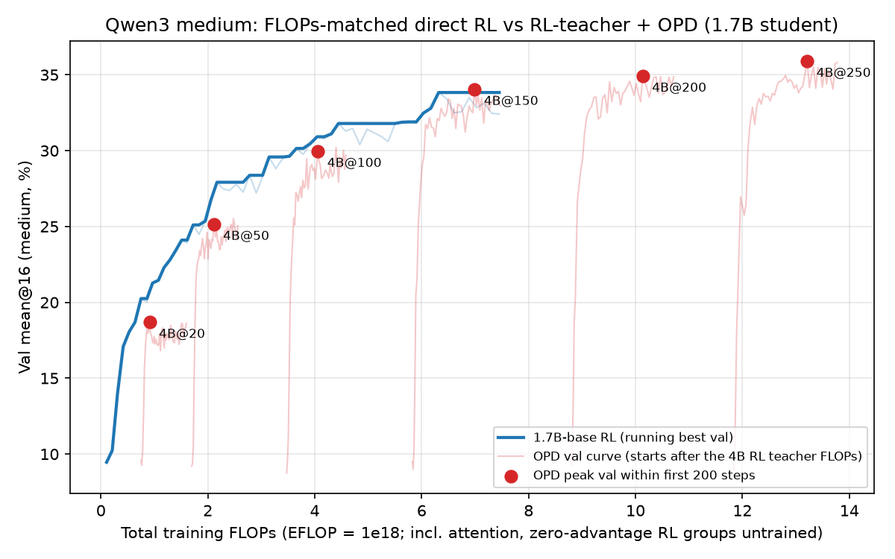

# Qwen3 results: RL vs distillation (1.7B / 4B / 8B, with 30B-A3B teachers)

Last updated: 2026-10-26

This doc collects every Qwen3 result from the distill-vs-RL study in one place. The chronological source is
[`../PROGRESS_LOG.md`](../PROGRESS_LOG.md). The generated per-set math-suite table is
[`QWEN3_MATH_SUITE_RESULTS.md`](QWEN3_MATH_SUITE_RESULTS.md). Recipes are in [`RECIPES.md`](RECIPES.md), ScaleTrain
operations in [`OPERATIONS.md`](OPERATIONS.md), and the Gemma 4 counterpart in [`GEMMA4_RESULTS.md`](GEMMA4_RESULTS.md).

All numbers are val **mean@16 in percent** on the band's 300-question validation split unless the text says otherwise.
"best @ N" means the best validation step. S3 paths are relative to `s3://scale-ml/genai/rl-distill/` (written `B/`).

---

## 1. Headline findings

1. **Direct RL vs off-policy (forward-KL, top-128) distillation from an RL teacher: RL wins mean@k at both student sizes.**
   - 4B students: RL 65.8 / 41.2 vs 30B→4B 52.2 / 34.4 (medium / hard).
   - 1.7B students: RL 33.8 / 12.6 (first runs) vs the best distillation, 28.6 / 11.9 from the 4B teacher.
   - On pass@16 the two are roughly tied.
   - Off-policy students are mode-covering: 1.2–2.3× the teacher's per-token entropy, with the most distinct answers.
2. **On-policy distillation (PG-k1) beats direct RL at 1.7B and roughly ties it at 4B.**
   - Two-stage (off-policy, then ≤120 OPD steps) 1.7B students average 39.7–39.8 mean@n over the 8-set math suite, vs 36.0
     for the best 1.7B RL.
   - From the base (no off-policy stage), 4B-RL→1.7B OPD beats 1.7B RL on every band: +1.4 / +2.8 / +5.4 (easy / medium / hard).
3. **The bigger teacher is often the worse teacher.**
   - For 1.7B, the 4B RL teacher beats both the 30B-A3B teacher (off-policy and OPD) and the 8B teacher (OPD from base).
   - 8B→4B OPD trails 4B RL by 0.8 / 4.7 / 6.7 points.
   - 8B RL ≈ 4B RL after training (91.3 / 68.3 / 40.8 vs 89.1 / 65.8 / 41.2), even though the 8B base starts higher.
4. **Same-size control.** 1.7B RL→1.7B-base OPD reproduces its teacher (72.5 / 34.5 / 13.7 vs 72.6 / 34.7 / 14.1) and adds
   nothing beyond it. The 4B→1.7B gain is therefore not an artefact of the OPD objective.
5. **FLOP-matched (1.7B medium).**
   - Below ~6 EFLOP, direct RL leads by 0.9–1.7.
   - Teacher-RL + OPD ties at 4B@150 and passes the RL plateau (34.7) by +0.2 / +1.2 at 4B@200 / 4B@250.
6. **Pre-training vs capacity ablation (in progress).**
   - On-policy base→base pre-distillation collapsed entropy and was abandoned.
   - Off-policy forward-KL with a tail bucket works for small→big: 4B′ matches the 1.7B base in pass@1..32 and entropy.
   - It fails for big→small: 1.7B′ stays at the 1.7B-base level.
   - RL from 4B′ (Exp 1) is running as of 2026-10-26.
7. **very_hard band (discontinued 2026-10-25).** It is the worst training band for every method. Gains are limited by its
   3,000-question train set: RL memorizes after ~11–21 epochs.

---

## 2. Setup

### Models (pinned Hub revisions)

| tag | model | revision | RL GPUs | notes |
|---|---|---|---|---|
| q1p7b | `Qwen/Qwen3-1.7B-Base` | `ea980cb0a6c2ae4b936e82123acc929f1cec04c1` | 2 | dense, tied embeddings |
| q4b | `Qwen/Qwen3-4B-Base` | `906bfd4b4dc7f14ee4320094d8b41684abff8539` | 4 | dense, tied |
| q8b | `Qwen/Qwen3-8B-Base` | `49e3418fbbbca6ecbdf9608b4d22e5a407081db4` | 4 | dense, untied, 16 GiB KV, 4 GiB weight-sync buckets |
| q30b | `Qwen/Qwen3-30B-A3B-Base` | `1b75feb79f60b8dc6c5bc769a898c206a1c6a4f9` | 8 | MoE, teacher only (training code out of scope), R3 replay, GEN_TP=2 |

The Qwen3 base family was chosen 2026-10-04 because all sizes share the same 36T pretraining tokens (Qwen3 report).
Qwen3-14B-Base was added 2026-10-26 (§5.6).

### Prompt and grading

- The prompt is 0-shot native ChatML ([`../data/qwen3_base_native_chat.jinja`](../data/qwen3_base_native_chat.jinja)) plus
  `Please reason step by step, and put your final answer within \boxed{}.` (~135 prompt tokens).
  - Without the instruction the bare question was boxed only 54% of the time; with it, ~87–89%.
  - Stops: `<|im_end|>` / `<|endoftext|>` / `<|im_start|>` ids (151645 / 151643 / 151644), plus the plain-text `\nHuman:` / `\nuser\n`.
- Sampling: temp 1, top-p 1, 8192 response tokens.
- Grading uses strict last-`\boxed{}` math_verify (= the RL reward). Trained models box ~100% of responses; bases box 70–81%.

### Difficulty bands

The bands come from HF dataset `JWei05/DeepScaleR-Easy-Medium-Hard-Qwen3-30B-A3B-Base-10k` (public).
- easy / medium / hard: revision `be4dcd8b`. very_hard: revision `9bec69ca`.
- Builders: `data/build_deepscaler_qwen3_30b_difficulty_dataset.py`, `data/build_deepscaler_qwen3_30b_very_hard_band.py`.
- RL data prep: `data/prepare_deepscaler_qwen3_30b_difficulty_rl_data.py`.

The pool is 38,796 deduplicated DeepScaleR questions, graded with Qwen3-30B-A3B-Base at n=8 under the prompt above. That
grading gave mean@8 33.9%, pass@8 76.3%, boxed 87.7%. For comparison, the 8B base gives mean@8 28.5% and pass@8 71.1%.

| band | definition (30B base k/8) | pool | released |
|---|---|---|---|
| easy | 4–8 / 8 | 13,859 | 3,000 train / 300 val |
| medium | 2–3 / 8 | 9,315 | 3,000 / 300 |
| hard | 1 / 8 | 6,440 | 3,000 / 300 |
| very_hard (discontinued) | 0/8, then ≥1/16 in a 16-sample resample (seed 1042) | 3,634 of 9,182 | 3,000 / 300 |

- Selection: SHA-256 hash rank (seed 42), then validation split (seed 43).
- Resample of the 9,182 questions at 0/8: 39.6% were solved at least once in 16 new samples and 60.4% stayed 0/16. Output:
  `B/qwen3-deepscaler-samples/qwen3-30b-a3b-base-0shot-qwenmath-zero8-n16-seed1042-8k/`.
- n=8 sample bundles: `B/qwen3-deepscaler-samples/qwen3-{8b,30b-a3b}-base-0shot-qwenmath-n8-8k/`.
- Earlier 300-q band sets (2026-10-05, 8B- and 30B-defined bands, `data/build_qwen3_teacher_band_sets.py`) used different
  questions. They live in `B/qwen3-deepscaler-samples/band_sets/` and `band_evals/`. On them, 30B-defined bands were harder
  for 1.7B / 4B than 8B-defined bands at equal teacher accuracy.
- Gemma overlap (`analysis/compare_gemma_qwen_band_overlap.py`):
  - Qwen 30B solves far more questions than Gemma 26B (mean pass rate 0.339 vs 0.104).
  - Qwen hard is 84% Gemma-0/8.
  - The Qwen and Gemma bands are not interchangeable.

### Eval protocols and metric caveats

- **RL-logged val**: `val-core/math/acc/mean@16` every 10 steps (300 q × 16). mean@16 is exact.
- **verl `best@16` is a with-replacement bootstrap** (≈ pass@10, not pass@16). A question with c/16 correct counts
  1−(1−c/16)^16, so a single hit scores 0.64. Compare it only with other RL-logged best@N. **Never** compare it with offline
  pass@k (unbiased combinatorial estimator, `eval/eval_math_passk.py`, band-eval and math-suite `summary.json`).
- **Selection bias**: re-evaluating an RL best checkpoint gives 0.3–1.5 points below its logged best (max over ~50 evals).
  One eval's SE is ~0.4–0.6 points on a 300-q set. A 300-q pass@16 SE is ~2.8 points.
- **Band-val evals** (distill pipeline stage 3, re-evals): n=16 (n=32 for the pass@32 and pre-distill evals), unbiased pass@k / pass^k.
- **Math suite**: 8 sets, n=16 (AIME n=32), summarized in [`QWEN3_MATH_SUITE_RESULTS.md`](QWEN3_MATH_SUITE_RESULTS.md).
  - Sets: easy / medium / hard / very_hard val, GSM8K test 1,319, MATH500, AIME 2025 / 2026 (30 q each).
  - On AIME, one question moves pass@32 by 3.3 points.

### RL recipe (all sizes)

The launcher is [`../scale_train/launch_qwen3_30b_a3b_medium_rl.sh`](../scale_train/launch_qwen3_30b_a3b_medium_rl.sh). It
serves every size despite its name: `QWEN_SIZE=1.7b|4b|8b|30b-a3b BAND=...`. The supervisor is
`scale_train/start_qwen3_30b_a3b_medium_rl_supervisor.sh`.

- DAPO/GRPO with n=16, 64 prompts per step, mini-batch 32, lr 1e-6 (20 warmup, constant).
- Clip 0.2 / 0.28, token-mean loss, token TIS 2.
- 8k responses + 2k soft overlong buffer, no KL / entropy term.
- Validation before training and every 10 steps.
- Early stopping (`es5`): 5 consecutive vals more than 1 point below the best; a score within 1 point resets the streak.
  Newer runs (`es10`) use patience 10.
- Checkpoints: permanent every 10 (model + Adam + LR / RNG + dataloader + HF export) and rolling every 5.
  `best_hf` is published at the end.
- Micro-batching: 4 seqs / 8192 padded tokens; the 4B / 1.7B easy runs use 8 / 16384.
- Step caps: 1.7B / 4B 600, 8B 500, 30B 400→500. Several runs were later extended (§3).

---

## 3. RL grid

The S3 `best_hf` for each run is `B/qwen3-<size>-base-rl/qwen3-<size>-<band>-es5/best_hf`; for 30B it is
`B/qwen3-30b-a3b-base-rl/qwen3-30b-a3b-<band>-es5/best_hf`. Full checkpoints are at
`B/qwen3-<size>-base-rl-full-checkpoints/qwen30b-<band>-es5/global_step_N/`; the `qwen30b-` prefix names the band source, not
the model. W&B runs are `rl-distill/DAPO/q3-<size>-<band>-es5-s42-v1`, with size `1.7b`, `4b`, `8b` or `30b-a3b`.
Best / final steps match `run_outcome.json` on S3 (checked 2026-10-26).

| size | band | step 0 | best val @ step | final step (stop reason) | history |
|---|---|---|---|---|---|
| 1.7B | easy | ~32 † | **72.6 @470** | 600 (max steps) | |
| 1.7B | medium | 9.1 | **34.7 @680** | 760 (early stop) | first run 33.8 @520 at the 600 cap; resumed 600→1000 on 10-24. Step-520 copy is in `<ckpt>/archive_first_run/best_hf_step520/` |
| 1.7B | hard | 3.8 | **14.1 @910** | 1000 (max steps) | first run 12.6 @550 at the 600 cap; resumed 600→1000 on 10-24 |
| 4B | easy | 44.5 | **89.1 @500** | 600 (max steps) | |
| 4B | medium | 21.0 | **65.8 @510** | 590 (early stop) | 400 cap (0.644 @350), extended to 600. Step-400 best is in `best_hf_at_step400/` |
| 4B | hard | 8.6 | **41.2 @560** | 600 (max steps) | 400 cap (38.2 @390), extended to 600. Then dropped to 36.4 / 38.7 / 36.2. Step-390 best is in `best_hf_at_step400/` |
| 8B | easy | 57.0 | **91.3 @460** | 500 (max steps) | fully stable |
| 8B | medium | 27.6 | **68.3 @480** | 610 (early stop) | first early stop @330 (64.7 @270); 330→500 with `EARLY_STOPPING_RESET_PATIENCE_AT_STEP`; 500→800 then early-stopped @610 with no new best. Overfits after ~450 |
| 8B | hard | 12.6 | **40.8 @310** | 390 (early stop) | first early stop @220 (36.9 @170); 220→500 with reset. Rerun of 10-26 cancelled (§5.6) |
| 30B-A3B (teacher) | medium | 31.1 | **75.75 @320** | 420 (early stop) | |
| 30B-A3B (teacher) | hard | 13.6 | **62.5 @410** | 500 (= cap and 5th miss) | |

† The 1.7B easy step-0 value is not in the log. ~32 is the 1.7B base's step-0 val on easy in the OPD runs (32.0); the math
suite gives 31.4.

Notes:

- **Plateau audit (10-24).**
  - Plateaued or declining at their caps: 1.7B easy, 4B easy, 4B medium, 4B hard, 8B easy.
  - 8B medium / hard had been stopped while still improving: a 5-eval dip inside the 1-point tolerance tripped patience 5,
    3.6–3.9 points early. Those two runs were extended, which led to patience 10 (`es10`) for new runs.
  - Replaying patience 10 + 1-point tolerance never stops any of the 9 main RL curves before its best.
- **Entropy (10-26).**
  - Every run collapses entropy to ~0.13–0.20 by step 50–150, then lets it grow (no entropy term, clip-higher 0.28).
  - 8B hard is the outlier. Entropy jumped 0.20→0.48 at ~step 160–180: training reward stalled ~60 steps, val fell
    36.9→33.9, and per-sequence ppl spiked up to 4.5k. It recovered, then ran away 0.55→0.93 at steps 340–400 while
    training accuracy fell.
  - There was no infra fault: the trainer-vLLM log-ppl gap was ~0.001.
  - Recipe ablations (lr 5e-7, symmetric clip) were proposed but not launched.
- **8B ≈ 4B after RL** despite higher bases (57.0 / 27.6 / 12.6 vs 44.5 / 21.0 / 8.6). 8B led 4B at every common step.

### very_hard RL (discontinued 2026-10-25)

Same recipe, launched with `BAND=very_hard`. W&B runs are `q3-<size>-very_hard-es5-s42-v1`; S3 is `.../qwen3-<size>-very_hard-es5/`.

| size | step 0 | best @ step | final (stop reason) |
|---|---|---|---|
| 1.7B | 3.1 | 12.4 @810 | 1000 (max steps; extended 600→700→1000. First run 10.8 @550; +100 gave 11.5 @680) |
| 4B | 6.7 | 24.4 @620 | 700 (early stop; first run 24.3 @540 at the 600 cap) |
| 30B-A3B | 11.2 | 39.5 @460 | 550 (early stop; first run cap 500) |

- These runs learn about half as fast per step as on hard.
- Val was flat for the last 100–200 steps while training accuracy kept rising. For 1.7B: +0.25 val per 100 steps vs
  training accuracy 14→27 over ~21 epochs. More fresh questions would help, not more steps.
- First-run markers are archived under `<ckpt>/archive_first_run/` and `archive_ext100/`.

---

## 4. Off-policy top-k distillation (forward KL, top-128)

### Pipeline

The pipeline is [`../scale_train/run_qwen3_30bm_to_4b_distill_st.sh`](../scale_train/run_qwen3_30bm_to_4b_distill_st.sh),
driven by `TEACHER_SPEC` + `STUDENT`. It is launched through `launch_qwen3_30bm_to_4b_distill_st.sh` /
`start_qwen3_30bm_to_4b_distill_supervisor.sh`.

1. **Traces** from the teacher's RL best `global_step_N/actor/huggingface`: 3000 train q × 16 + 300 val q × 1, top-128
   logprobs, temp 1, 8192 tokens. This gives 48,300 rows per bundle.
2. **Distill** with batch 128 and lr 2e-6 → 2e-7 (100 warmup, linear) for 1000 steps (~2.7 epochs).
   - Val KL every 10 steps.
   - Micro-batches of 4 seqs / 8192 tokens, KL chunk 4096.
   - Permanent checkpoint + HF export every 250 steps.
   - These RL-teacher runs had **no tail bucket**. The tail bucket was added 2026-10-26 for the `*-base-all` specs.
3. **Eval** steps 250 / 500 / 750 / 1000 on the band's val split (n=16).

Artifact layout (`<family>` = `qwen3-30b-rl` or `qwen3-4b-rl`; `<spec>` e.g. `q30bh-hard`):

- traces: `B/<family>-traces-topk128-v1/<spec>/`
- checkpoints: `B/<family>-distill-ckpts-v1/<spec>-to-<q4b|q1p7b>-bs128-s1000-lr2e-6/global_step_{250,500,750,1000}/`
- evals: `B/<family>-distill-evals-v1/<same>/step_*/summary.json`
- W&B projects: `rl-distill/qwen3-30b-rl-distill-v1`, `rl-distill/qwen3-4b-rl-distill-v1`

Teachers are the RL bests: 30B medium @320, hard @410, very_hard @460; 4B medium @510, hard @560, very_hard @620.

### Results (in-distribution val, mean@16 / pass@16 at the best distill step)

| teacher → student | medium | hard | very_hard (disc.) | W&B run (medium / hard / very_hard) |
|---|---|---|---|---|
| 30B RL → 4B | 52.2 / 93.3 (@1000) | 34.4 / 86.7 (@1000) | 19.6 / 61.7 (@1000) | 7d4h349i / su6s8dee / djbjgba4 |
| 30B RL → 1.7B | 25.9 / 75.7 (@1000) | 11.3 / 53.0 (@1000) | 7.5 / 42.3 (@750) | gt36keuc / ppt88udx / dr48mkts |
| 4B RL → 1.7B | **28.6 / 78.3** (@750) | **11.9 / 54.0** (@1000) | **10.0** / 46.0 (@1000) | kowg1frk / r9gsjy95 / cn9a1nh2 |
| direct RL 4B (logged best) | 65.8 | 41.2 | 24.4 | |
| direct RL 1.7B (logged best, first runs) | 33.8 | 12.6 | 12.4 | |

Per-step curves (mean@16 at steps 250 / 500 / 750 / 1000):

- 30B → 4B medium: 48.8 / 51.9 / 51.5 / 52.2. Val KL is flat after ~250 (0.0469 → 0.0455).
- 30B → 4B hard: 29.5 / 32.7 / 32.3 / 34.4. Val KL 0.0765 → 0.0727; still rising at 1000.
- 30B → 1.7B medium: 22.8 / 23.7 / 25.3 / 25.9. Hard: 9.8 / 11.2 / 11.1 / 11.3.
- 4B → 1.7B medium: 25.9 / 26.2 / 28.6 / 27.7. Hard: 10.3 / 11.1 / 11.5 / 11.9.
- very_hard: 30B → 4B 14.9 / 18.1 / 18.9 / 19.6; 4B → 1.7B 8.8 / 9.5 / 9.2 / 10.0; 30B → 1.7B 6.5 / 6.7 / 7.5 / 7.3.

Takeaways:

- Distillation recovers ~57% (medium) and ~48% (hard) of the base→teacher gap at 4B. Most of the gain lands by step 250.
- The weaker 4B teacher gives the better 1.7B student on every band, despite a higher KL to its teacher. The 30B→1.7B KL is
  ~1.6× the 4B student's.
- On pass@16 distillation roughly equals RL. On medium RL ≥ distill (4B 93.7 vs 93.3, 1.7B 80.0 vs 78.3). On hard distill ≥ RL
  (86.7 vs 85.7, 54.0 vs 51.0). On very_hard, distill pass@16 is 66.3 vs RL 63.3 at 4B and 47.0 vs 42.7 at 1.7B. All of these
  are within noise.

### Small → big control (4B base → 30B base), one line

An off-policy top-128 distill of the untrained 4B into the 30B base erases the 30B's advantage within 250 steps.
- Medium mean@32 / pass@32: student 18.2 / 90.3, 4B teacher 20.8 / 92.7, 30B base 27.9 / 99.0.
- Hard: 7.9 / 73.7 vs 8.6 / 72.0.
- Details in [`../figures/qwen3_distill_vs_teacher.md`](../figures/qwen3_distill_vs_teacher.md) §A.
- Artifacts: `B/qwen3-4b-base-traces-topk128-v1/q4b-base-{medium,hard}/`,
  `B/qwen3-4b-base-distill-ckpts-v1/q4b-base-<band>-to-q30b-bs128-s1000-lr2e-6/`, pass@32 evals in
  `B/qwen3-passk32-evals-v1/`, W&B `qwen3-4b-base-distill-v1`.
- Without a tail bucket, the student's own-sample entropy stays at the 30B base's level (0.43–0.46 vs teacher 0.96–0.97).
  This is the reason the tail bucket was added.

---

## 5. On-policy distillation (PG-k1)

### Recipe

The launcher is [`../scale_train/launch_qwen3_onpolicy_distill.sh`](../scale_train/launch_qwen3_onpolicy_distill.sh),
called as `SPEC=<teacher>[-s<step>]-to-<student>[-base]`. The supervisor is `start_qwen3_onpolicy_distill_supervisor.sh`.

- Per-token advantage A_t = sg[log π_T(y_t) − log π_student(y_t)], sampled-token k1 with `use_policy_gradient=True`.
  - No task reward and no normalization.
  - Clipped to ±5 (MOPD).
- IcePop token IS mask [0.5, 2] between trainer and vLLM.
- 128 prompts × 1 sample per step and one update per step, so the PPO clip is inactive.
- Token-mean loss; temp 1.
- Validation is the RL contract (band val300 × 16, mean@16).
- vLLM TP1 for students and for the 1.7B / 4B / 8B teachers; TP2 for the 30B teacher (with actor offload). 1.7B students use
  2 GPUs, 4B students use 4.

Outputs:
- `B/qwen3-opd/<SPEC>-<RUN_TAG>/best_hf`
- `B/qwen3-opd-full-checkpoints/<SPEC>-<RUN_TAG>/`
- W&B `rl-distill/DAPO/q3-opd-<SPEC>-<RUN_TAG>-s42`

| RUN_TAG | lr / warmup | steps | early stopping | used for |
|---|---|---|---|---|
| `pgk1-v1` | 2e-6 / 20 | 120 (4 runs launched at 150, stopped at 120) | off | two-stage: off-policy step-1000 student → OPD (§5.1). Code pinned to `5c6d47d5` (before the `global_batch_info` fix `07e9460f`) |
| `pgk1-base-v1` | 2e-6 / 20 | 250 (extensions to 500) | off; extensions and controls: no +0.5 in 100 steps | from base: FLOP sweep, dense-ladder grid, controls (§5.2–5.3) |
| `pgk1-pre-v1` | 2e-6 / 20 | 250 | off | base→base pre-distillation (abandoned, §5.4) |
| `pgk1-base-lr1e6w50` | 1e-6 constant / 50 | cap 400 | no +0.5 in 100 steps (patience 10, min_delta 0.005) | v2 recipe (§5.5) |

### 5.1 Two-stage: off-policy student → OPD (`pgk1-v1`, 2026-10-20/21)

Each student starts from its off-policy step-1000 checkpoint and uses the same RL teacher and band. Validation is logged; the
best is at ≤120 steps.

| SPEC | off-policy start (val) | OPD best val @ step | math suite avg mean@n / pass@n: off → OPD |
|---|---|---|---|
| q4bm-to-q1p7b | 27.7 | **38.25 @120** | 33.7 / 62.9 → **39.7 / 66.2** |
| q4bh-to-q1p7b | 11.9 | **19.69 @110** | 32.8 / 61.2 → **39.8 / 68.0** |
| q4bvh-to-q1p7b (disc.) | 10.0 | 12.96 @110 | 31.3 / 62.2 → 35.9 / 63.7 |
| q30bm-to-q1p7b | 25.9 | 34.98 @110 | 32.1 / 62.0 → 36.9 / 64.9 |
| q30bh-to-q1p7b | 11.3 | 19.0 @100 | 31.8 / 63.5 → 39.2 / 68.1 |
| q30bvh-to-q1p7b (disc.) | 7.3 | 11.04 @100 | 28.7 / 59.9 → 34.3 / 62.5 |
| q30bm-to-q4b | 52.2 | 61.19 @110 | 46.7 / 73.8 → 50.0 / 74.8 |
| q30bh-to-q4b | 34.4 | 42.19 @120 | 50.1 / 77.9 → **54.9 / 77.7** |
| q30bvh-to-q4b (disc.) | 19.6 | 24.63 @100 | 43.4 / 71.3 → 47.8 / 73.1 |

Reference math-suite averages (mean@n / pass@n):
- 1.7B: base 15.0 / 51.2; RL medium 36.0 / 63.8; RL hard 33.5 / 63.1.
- 4B: base 21.1 / 64.8; RL medium 53.1 / 74.9; RL hard 54.1 / 79.4; RL very_hard 47.9 / 72.1.

In-distribution matrix (each band's val set, mean@16 / pass@16). Sources differ by column type:
- off: distill-pipeline eval at the best distill step.
- on: math-suite eval of the OPD best_hf. This is why 4B→1.7B medium shows 39.1 here vs the logged val of 38.25.
- RL: band-val re-eval of the best checkpoint (§6.2).

| band | 1.7B RL | 4B→1.7B off / on | 30B→1.7B off / on | 4B RL | 30B→4B off / on | 30B RL |
|---|---|---|---|---|---|---|
| medium | 33.1 / 80.0 | 28.6 / 78.3 → **39.1 / 84.0** | 25.9 / 75.7 → 33.9 / 80.7 | **65.5 / 93.7** | 52.2 / 93.3 → 59.7 / 94.3 | 74.3 / 96.3 |
| hard | 12.1 / 51.0 | 11.9 / 54.0 → **19.4 / 62.3** | 11.3 / 53.0 → 18.1 / 61.7 | 40.6 / 85.7 | 34.4 / 86.7 → **41.8 / 87.0** | 61.4 / 89.0 |
| very_hard | 12.1 / 42.7 | 10.0 / 46.0 → **12.7 / 50.3** | 7.5 / 42.3 → 10.2 / 49.0 | 23.7 / 63.3 | 19.6 / 61.7 → **24.0 / 66.0** | 38.4 / 76.3 |

Takeaways:
- At 1.7B, OPD > RL > off-policy on mean@k in every band, and OPD also has the best pass@k.
- At 4B (30B teacher only), OPD ≈ RL: hard 54.9 vs 54.1, very_hard 47.8 vs 47.9, medium 50.0 vs 53.1. RL hard keeps the best
  pass@n (79.4 vs 77.7).
- KL drops 15–25% and plateaus around step 40–60.

Caveats:
- OPD starts from the off-policy checkpoint, so OPD > off-policy is close to guaranteed.
- Compute is not matched: teacher RL + 1000 off-policy steps + ≤120 OPD steps.
- best_hf was selected on the band's own val set.
- Ops notes:
  - Runs that finished on their own got best_hf = their final step. They were re-published at the best-val step with
    `scale_train/publish_qwen3_opd_best_hf.sh`.
  - W&B lost step 120 for q4bm / q30bm; it was backfilled from pod logs (`scale_train/wandb_backfill_step_from_pod_log.py`).

Math-suite models: registry `scale_train/qwen3_math_suite_models.sh` `suite_models opd` (`<spec>-opd120`). Watcher:
`scale_train/run_qwen3_opd_math_suite_watcher.sh`.

### 5.2 FLOP-matched sweep: intermediate 4B medium RL teacher → 1.7B base (`pgk1-base-v1`)

- SPEC `q4bm-s<K>-to-q1p7b-base`: the teacher is `B/qwen3-4b-base-rl-full-checkpoints/qwen30b-medium-es5/global_step_<K>`.
- 250 steps, validation every 5. Code = HEAD, which includes `07e9460f`.

| 4B teacher step K | 20 | 50 | 100 | 150 | 200 | 250 | 510 (anchor = RL best) |
|---|---|---|---|---|---|---|---|
| teacher val | 30.5 | 43.2 | 51.2 | ~57 | | | 65.8 |
| student best val @ step | 18.7 @50 | 25.5 @225 | 30.2 @210 | 34.0 @180 | 34.9 @175 | 35.9 @180 | **37.3 @210** (final 36.3) |
| peak within OPD steps 1–200 (FLOP plot) | 18.7 (50) | 25.1 (120) | 30.0 (135) | 34.0 (180) | 34.9 (175) | 35.9 (180) | — |

- A stronger teacher checkpoint gives a stronger student.
- Anchor vs two-stage at the same 4B@510 teacher: 37.3 from base vs 38.2 @120 two-stage. The off-policy stage is worth ~1 point
  and makes OPD ~2× faster in OPD steps.
- The figure is in §7.

### 5.3 Dense-ladder OPD-from-base grid (`pgk1-base-v1`, complete 2026-10-26)

- Teachers are pinned to their RL best step: 4B e@500 / m@510 / h@560; 8B e@460 / m@480 / h@310. Students start from the
  untrained base.
- 250 steps with no early stopping. The 4B→1.7B runs were then extended 250→500 with early stopping (no +0.5 in 100 steps).
  Their pre-ES history was seeded from W&B via `scale_train/build_es_migration_from_wandb.py`.

| band | RL 1.7B | RL 4B | RL 8B | 4B→1.7B | 8B→1.7B | 8B→4B |
|---|---|---|---|---|---|---|
| easy | 72.6 | 89.1 | 91.3 | **74.0** @340 | 73.2 @240 | 88.3 @240 |
| medium | 34.7 | 65.8 | 68.3 | **37.5** @260 | 33.5 @230 | 61.1 @245 |
| hard | 14.1 | 41.2 | 40.8 | **19.5** @215 | 15.3 @225 | 34.5 @215 |

- 4B→1.7B, first 250 steps: easy 73.9 @245, medium 37.3 @210, hard 19.5 @215 (final 19.1).
- The extensions early-stopped at easy 440 (74.0 @340), medium 360 (37.5 @260), and hard 350 (no new best on the step-10
  evals; 19.1 @250). Steps beyond 250 are worth only +0.1–0.2.
- Two-stage comparison at the same teachers: medium 38.2 @120, hard 19.7 @110.
- Deltas vs student RL:
  - 4B→1.7B: +1.4 / +2.8 / +5.4.
  - 8B→1.7B: +0.6 / −1.2 / +1.2.
  - 8B→4B: −0.8 / −4.7 / −6.7.
- 8B→4B easy reaches 87.8 by step 70 and then plateaus around 87.
- **Same-size controls** `q1p7b{e,m,h}-s{470,680,910}-to-q1p7b-base` (cap 500, early stopping on):
  - Results: easy 72.5 @130 (stop 230), medium 34.5 @90 (stop 190), hard 13.7 @80 (stop 180).
  - Each reaches its teacher's val within ~60–130 steps with k1 ~0.001–0.004, and gains nothing beyond it.
- Analysis of OPD from base:
  - Gains land mostly by step 100–150, then ~+1 point per 100 steps.
  - k1 closes 95% of its gap by step 37–111.
  - RL-style 1-point-tolerance early stopping never fires. A "+0.5 in 100 steps" min_delta rule would stop flat runs at a cost
    of ≤0.4 points.
- **Caveat**: `best_hf` for the no-ES 250-step runs is the **final step**. Re-publish the best-val step (from W&B) before
  running any math suite on them. The pod logs miss 22:28Z–07:00Z on 10-23/24 because of a ScaleTrain API outage.

### 5.4 Pre-training vs capacity ablation (4B → 1.7B gain)

**Question.** 4B-RL → 1.7B-base OPD beats 1.7B RL. Is the gain from the 4B's pre-training (P) or from its capacity / RL
optimization (C)? The design is a 2×2: every teacher is RL-trained on the band and then on-policy distilled into the 1.7B
base. The baseline is direct 1.7B RL.

| cell | teacher | status |
|---|---|---|
| control (P 1.7B, C 1.7B) | 1.7B RL → 1.7B base | done: matches the teacher (§5.3) |
| main (P 4B, C 4B) | 4B RL → 1.7B base | done: +1.4 / +2.8 / +5.4 |
| Exp 1 (P 1.7B, C 4B) | 4B′ (4B base distilled from the 1.7B base) → RL → 1.7B base | RL running as of 2026-10-26 |
| Exp 2 (P 4B, C 1.7B) | 1.7B′ (1.7B base distilled from the 4B base) → RL → 1.7B base | on hold (1.7B′ ≈ 1.7B base) |

**Attempt 1: on-policy pre-distillation (`pgk1-pre-v1`, 2026-10-25). Abandoned 10-26.**
- Specs: `qb1p7b{e,m,h}-to-q4b-base` and `qb4b{e,m,h}-to-q1p7b-base`, with the teacher being the pinned Hub base.
- Reverse KL to a high-entropy base teacher collapses the student's entropy. Own-sample NLL per token went from ~0.9 to ~0.5
  within 50 steps in both directions, with k1 plateauing at 0.05–0.07.
- best@16 stays well below the source base.
- On medium / hard, 4B′ and 1.7B′ converge to the same mid-level accuracy (~14 / ~5.5), so neither is a copy of its source.
- Report: [`../figures/qwen3_predistill_inspection.md`](../figures/qwen3_predistill_inspection.md) and `.png` / `.json`
  (`analysis/qwen3_predistill_inspection.py`). Example, 4B′ medium @250: 14.6 vs target 9.2, NLL 0.52 vs 0.89.
- The two unfinished runs were cancelled.

**Attempt 2: off-policy forward-KL pre-distillation with a tail bucket (2026-10-26, done ~14:00Z).**
- Specs `q1p7b-base-all` → q4b (= 4B′) and `q4b-base-all` → q1p7b (= 1.7B′), one run per direction over the union of the
  easy + medium + hard train splits.
- Traces: 9000 q × 8 = 72k rows, top-128, temp 1, 8192 tokens.
- Training: batch 128, lr 2e-6 → 2e-7 (100 warmup), 1000 steps (1.78 epochs).
- Tail bucket p_tail·log(p_tail/q_tail) (`TOPK_KL_TAIL_BUCKET`, `b9f594c7`) on 4 GPUs.
- Evals: steps 0 / 250 / 500 / 750 / 1000 on each band at n=32, with pass@k for all k ≤ 32 and own-sample NLL.
- Report: [`../figures/qwen3_distill_vs_teacher.md`](../figures/qwen3_distill_vs_teacher.md) §B and `.png` / `.json`
  (`analysis/qwen3_distill_vs_teacher_report.py`).
- The tail bucket worked. Student mass on the teacher's top-128 stays at or just below the teacher's (0.961 vs 0.964;
  0.952 vs 0.957). Without it, the 30B runs reached 0.986 vs 0.970.

| model (mean@32 / pass@32 / NLL per token) | easy | medium | hard |
|---|---|---|---|
| 1.7B base (4B′ teacher) | 31.2 / 92.7 / 0.953 | 9.3 / 67.3 / 0.988 | 3.7 / 44.0 / 1.012 |
| **4B′ @750** | 29.4 / 92.3 / 0.986 | 8.7 / 63.7 / 1.033 | 3.9 / 44.7 / 1.049 |
| 4B′ @1000 (picked) | 29.5 / 91.3 / 1.043 | 8.0 / 61.0 / 0.980 | 3.8 / 43.7 / 1.083 |
| 4B base (1.7B′ teacher) | 44.4 / 98.7 / 1.241 | 20.6 / 92.7 / 1.042 | 8.4 / 70.3 / 0.882 |
| 1.7B′ @1000 | 29.1 / 92.0 / 1.079 | 8.7 / 66.3 / 1.059 | 3.5 / 39.7 / 1.055 |

- Forward KL including the tail: 4B′ 0.079 → 0.048; 1.7B′ only 0.088 → 0.073.
- 4B′ matches its teacher; 1.7B′ copies style (entropy, length) but not ability. Exp 2 therefore cannot separate P from C.
- Artifacts:
  - traces: `B/qwen3-4b-base-traces-topk128-v1/{q1p7b,q4b}-base-all/`
  - checkpoints: `B/qwen3-4b-base-distill-ckpts-v1/q1p7b-base-all-to-q4b-bs128-s1000-lr2e-6/` and
    `.../q4b-base-all-to-q1p7b-bs128-s1000-lr2e-6/`
  - evals: `B/qwen3-4b-base-distill-evals-v1/<same>/step_<N>/<band>/summary.json`
  - W&B `qwen3-4b-base-distill-v1`

**Exp 1 RL (4B′ RL), running as of 2026-10-26.**
- The user picked **4B′ step 1000** (final checkpoint, lowest KL). Init:
  `B/qwen3-4b-base-distill-ckpts-v1/q1p7b-base-all-to-q4b-bs128-s1000-lr2e-6/global_step_1000/huggingface` (`INIT_MODEL_S3_URI`).
- 4B RL recipe on easy / medium / hard: cap 1000, early stopping patience 10 + 1-point tolerance, `RUN_TAG=p4b1000-es10`,
  4 GPUs, borrowing false.
- W&B `q3-4b-<band>-p4b1000-es10-s42-v1`. S3 `B/qwen3-4b-base-rl/qwen3-4b-<band>-p4b1000-es10/` and
  `B/qwen3-4b-base-rl-full-checkpoints/qwen30b-<band>-p4b1000-es10/`.
- Next step: OPD from each 4B′-RL best into the 1.7B base (cap 500, +0.5 / 100-step early stopping), compared against 1.7B RL.

### 5.5 OPD recipe v2 (`pgk1-base-lr1e6w50`, launched 2026-10-26)

**Why:** v1's lr 2e-6 with 20-step warmup overshot in the first ~50 steps (grad norm ~3, response length 2.8k ± 0.8k, 8%
truncated).

**v2 settings:**
- Constant lr 1e-6 after a 50-step linear warmup.
- Cap 400 steps.
- Early stopping: stop when there is no +0.5 gain in 100 steps (patience 10, min_delta 0.005, validation every 10).
- Rolling checkpoint every 5; permanent checkpoint + HF export every 10.
- Borrowing true, `MAX_RELAUNCHES=200`. Commit `8186d486`.

**Launch:** [`../scale_train/launch_qwen3_opd_recipe_v2_batch.sh`](../scale_train/launch_qwen3_opd_recipe_v2_batch.sh)
(`--launch`; dry run with no flag). The 7 ladder specs:

| SPEC | status (as of 2026-10-26 ~20:20Z) |
|---|---|
| q4be-s500-to-q1p7b-base | running as of 2026-10-26 |
| q4bm-s510-to-q1p7b-base | running as of 2026-10-26 |
| q4bh-s560-to-q1p7b-base | running as of 2026-10-26 |
| q8be-s460-to-q1p7b-base | cancelled ~20:20Z, ≤ step 25 (8B→14B switch) |
| q8bm-s480-to-q1p7b-base | cancelled ~20:20Z |
| q8be-s460-to-q4b-base | cancelled ~20:20Z |
| q8bm-s480-to-q4b-base | cancelled ~20:20Z |

- Outputs: `B/qwen3-opd/<SPEC>-pgk1-base-lr1e6w50/`; W&B `q3-opd-<SPEC>-pgk1-base-lr1e6w50-s42`.
- The same-size controls and the 30B-teacher from-base runs were dropped from v2. The 8B hard teacher was excluded until its
  rerun finished; that rerun was then cancelled.
- **TODO after finish**: with min_delta, the early-stopping rule's "best" lags the true maximum. Re-publish best_hf at the best
  saved checkpoint.

### 5.6 Run status as of 2026-10-26

This section uses the newest entry in the main checkout's `PROGRESS_LOG.md` (~20:20Z). It supersedes the earlier same-day
"8B hard rerun + 7 OPD v2 runs live" status.

- **Running**: 4B′ RL ×3 (easy / medium / hard, `p4b1000-es10`) and OPD v2 4B→1.7B ×3.
- **Cancelled ~20:20Z (8B→14B switch, user)**:
  - Qwen3-8B hard RL rerun (`RUN_TAG=rerun-es10`, patience 10, cap 500, job_dbfotj0cdkag08afnh9g, at step ~2).
  - The four 8B-teacher OPD v2 runs.
  - All earlier 8B results above stand as recorded.
- **New, running as of 2026-10-26**: Qwen3-14B-Base RL on easy / medium / hard.
  - Same RL recipe, cap 1000, early stopping patience 10 + 1-point tolerance, `RUN_TAG=es10`.
  - Layout: 8 GPUs, FSDP2 DP8 without offload, vLLM 4 × TP2 with 16 GiB KV.
  - W&B `q3-14b-<band>-es10-s42-v1`; S3 `B/qwen3-14b-base-rl[-full-checkpoints]/`.
  - The `QWEN_SIZE=14b` launcher branch is commit `0573540a` in the main checkout and is not in this branch's launcher yet.

---

## 6. Evals and analyses

### 6.1 Math suite (8 sets)

Full table: [`QWEN3_MATH_SUITE_RESULTS.md`](QWEN3_MATH_SUITE_RESULTS.md), regenerated by `eval/summarize_qwen3_math_suite.py`.

- Runner: `scale_train/run_qwen3_math_suite_st.sh`, with `start_qwen3_math_suite_supervisor.sh` / `launch_qwen3_math_suite_st.sh`.
- Model registry: `scale_train/qwen3_math_suite_models.sh` (suites `v1`, `q4b`, `q1p7b`, `opd`).
- Results: `B/qwen3-math-suite-v1/<model>/<set>/summary.json`.

Headline rows, avg over the 8 sets (mean@n / pass@n):

| model | 1.7B | 4B |
|---|---|---|
| base | 15.0 / 51.2 | 21.1 / 64.8 |
| RL medium best | **36.0** / 63.8 | 53.1 / 74.9 |
| RL hard best | 33.5 / 63.1 | **54.1 / 79.4** |
| RL very_hard best (disc.) | 32.2 / 57.1 | 47.9 / 72.1 |
| best off-policy distill | 33.7 / 62.9 (4B-medium teacher); pass@n best 63.5 (30B hard) | 50.1 / 77.9 (30B hard) |
| best OPD (two-stage) | **39.8 / 68.0** (4B hard teacher); 39.7 / 66.2 (4B medium) | **54.9** / 77.7 (30B hard) |

- MATH500 mean@16: 4B base 39.9 → RL hard 84.0 → OPD 30B-hard 85.1. 1.7B base 30.1 → RL medium 66.2 → OPD 4B-hard 73.1.
- Hard-band training (RL or teacher) transfers to medium, MATH500 and AIME better than medium-band training. very_hard training
  is worst at both sizes, even on very_hard val.
- Qwen ≫ Gemma at equal scale: MATH500 base mean@16 is 39.9 (Qwen 4B) vs 10.9 (Gemma E4B). Gemma is evaluated 12-shot and Qwen
  0-shot.
- **Caveats**:
  - The 1.7B RL medium / hard rows were evaluated at steps 520 / 550, from the first runs. The current `best_hf` is 680 / 910
    after the continuations and has not been suite-evaluated.
  - The from-base OPD grid (§5.3) and the 8B models have no suite results yet.
  - An early 2026-10-09 v1 suite reported 7-set averages (e.g. 4B RL hard 57.7 / 80.1). These are superseded by the 8-set
    averages above.

### 6.2 Band-val re-evals of RL bests and bases (10-14)

Local scripts: `eval/local/run_qwen3_band_val_evals_local.sh` (`BAND=`) and `eval/local/run_qwen3_rl_ckpt_candidates_local.sh`.
The second was started and then stopped; it has no results. Outputs: `B/qwen3-<band>-val-evals-v1/<tag>/summary.json`. Each
cell is mean@16 / pass@16.

| model | medium | hard | very_hard (disc.) |
|---|---|---|---|
| 30B base | 29.3 / 95.7 | 13.8 / 84.7 | 9.2 / 68.7 |
| 4B base | 21.4 / 83.3 | 9.0 / 54.0 | 6.8 / 50.7 |
| 1.7B base | 9.6 / 55.7 | 3.8 / 32.3 | 3.3 / 30.3 |
| 30B RL best (320 / 410 / 460) | 74.3 / 96.3 | 61.4 / 89.0 | 38.4 / 76.3 |
| 4B RL best (510 / 560 / 620) | 65.5 / 93.7 | 40.6 / 85.7 | 23.7 / 63.3 |
| 1.7B RL best (520 / 550 / 810) | 33.1 / 80.0 | 12.1 / 51.0 | 12.1 / 42.7 |

On very_hard, RL raises pass@16 over the base (+8 / +13 / +12 for 30B / 4B / 1.7B). very_hard has many base-0/16 questions
that RL can unlock.

### 6.3 pass@32 (4B base → 30B base control)

- Runner: `scale_train/run_qwen3_passk32_evals_st.sh` (300 q × 32, unbiased pass@k for k ≤ 32).
- Results: `B/qwen3-passk32-evals-v1/<model>/<band>/summary.json`. Headline numbers are in §4; the full curves are in
  `figures/qwen3_distill_vs_teacher.md` §A.
- pass^32 is 0 for every model; the best question was 26/32.

### 6.4 Own-sample NLL / entropy

- Own-sample NLL per token of a model's own T=1 samples is used as the entropy estimate (`data/score_own_sample_nll.py`).
- For the 4B→30B students and the bases: `scale_train/run_qwen3_own_nll_st.sh` / `launch_qwen3_own_nll_st.sh`, output
  `B/qwen3-own-nll-v1/<name>/<band>/nll.json`.
  - 4B base 0.957 / 0.973 vs 30B base 0.406 / 0.458 (medium / hard).
  - The 30B students stay at 0.42–0.46 through step 1000.
  - 46% of the 4B base's own-sample NLL (0.52 of 1.12 nats per token) comes from the 5.3% of sampled tokens outside its top-128.
    This is the motivation for the tail bucket.
- For the `*-base-all` pre-distill students, the NLL is computed inside the pipeline's stage 3 (§5.4).
- OPD-student entropy is read from pod logs (`rollout_corr/training_log_ppl`) by `analysis/qwen3_opd_entropy_from_logs.py`.
  Teacher entropy is the mean NLL of the teacher's own trace tokens.

Per-token entropy in nats, medium / hard / very_hard:

| pair | teacher | off-policy student (FKL) | after OPD (RKL, steps 111–120) |
|---|---|---|---|
| 4B RL → 1.7B | 0.52 / 0.58 / 0.60 | 0.76 / 0.96 / 1.05 | 0.47 / 0.64 / 0.85 |
| 30B RL → 1.7B | 0.29 / 0.42 / 0.59 | 0.54 / 0.86 / 0.99 | 0.39 / 0.63 / 0.85 |
| 30B RL → 4B | 0.29 / 0.42 / 0.59 | 0.36 / 0.58 / 0.76 | 0.28 / 0.41 / 0.64 |

### 6.5 Answer diversity

`analysis/qwen3_answer_diversity.py` counts distinct last-box answers per question out of 16 math-suite samples on hard val.

| | off-policy | after OPD | direct RL |
|---|---|---|---|
| 1.7B students | 9.6–11.3 | 7.7–9.4 | 7.4–9.1 |
| 4B students | 6.9–8.0 | 5.6–6.3 | 5.2–5.7 |

- Forward KL is mode-covering. Reverse-KL OPD is mode-seeking and brings diversity back to roughly the RL level.
- OPD narrows pass@16 − pass@1 (e.g. 30B medium → 4B on medium: 41.2 → 34.6).
- pass@16 still rises at 1.7B because pass@1 rises much more. At 4B pass@16 is flat.

---

## 7. FLOP-matched OPD vs RL (1.7B, medium)

- Script: [`../analysis/qwen3_flops_matched_opd_vs_rl.py`](../analysis/qwen3_flops_matched_opd_vs_rl.py). Run it with
  `DIR --download` to fetch the W&B tables and history, then with `DIR` to build the ledger and plot.
- Figure: .
- Data: [`../figures/qwen3_flops_matched_opd_vs_rl_medium.json`](../figures/qwen3_flops_matched_opd_vs_rl_medium.json).
- Runs: `q3-1.7b-medium-es5-s42-v1`, `q3-4b-medium-es5-s42-v1`, and `q3-opd-q4bm-s{20..250}-to-q1p7b-base-pgk1-base-v1-s42`.

**Accounting choices (user-chosen):**
- "Essential" FLOPs only: no checkpoint recompute, padding, old-logprob recompute, validation, or LM head on prompt positions.
- Linear cost is 2·N per token per forward, with training = 3× forward. Attention scores add 2·L·n_q·d_h·S² per causal
  forward. Attention is only 5–12% of the total at ~1–2k-token responses.
- RL step: generation for all 1024 samples (prompt prefill once per group). Training is counted only on mixed-correctness
  groups, because all-0 / all-1 groups have zero GRPO advantage but still pay for generation. This cuts RL by 20%
  (1.7B: 9.4 → 7.5 EFLOP over 600 steps).
- OPD step: student generation + teacher scoring + student training, for all 128 samples.
- Per-sample lengths come from the per-step 100-trace W&B tables, rescaled to the logged batch means.
- Distill point: x = 4B RL FLOPs to step k + OPD FLOPs to its peak; y = peak val within OPD steps 1–200. A faint line shows
  the full OPD curve offset by the teacher FLOPs. The 4B@510 anchor is not plotted.

| 4B teacher step | 20 | 50 | 100 | 150 | 200 | 250 |
|---|---|---|---|---|---|---|
| EFLOP teacher + OPD-to-peak | 0.75 + 0.16 | 1.70 + 0.41 | 3.48 + 0.58 | 5.83 + 1.16 | 8.79 + 1.35 | 11.83 + 1.38 |
| total EFLOP | 0.91 | 2.11 | 4.06 | 6.99 | 10.13 | 13.21 |
| peak val (OPD step) | 18.7 (50) | 25.1 (120) | 30.0 (135) | 34.0 (180) | 34.9 (175) | 35.9 (180) |
| 1.7B RL running best at the same EFLOP (first run) | 20.2 | 26.8 | 30.9 | 33.8 | 33.8 | 33.8 |

**Final reading:** the 1.7B RL run was continued to step 760 (early stop), so its curve now ends at 9.8 EFLOP with best
34.7 @680 (8.6 EFLOP); past that point the plateau is drawn dashed.
- Below ~6 EFLOP, RL leads by 0.9–1.7.
- At 4B@150 they tie (34.0 vs 33.8).
- OPD passes the RL plateau by +0.2 (4B@200) and +1.2 (4B@250).

---

## 8. Artifact index

S3 prefixes, relative to `s3://scale-ml/genai/rl-distill/`:

| family | prefix |
|---|---|
| RL run artifacts (best_hf, run_outcome.json) | `qwen3-{1.7b,4b,8b,14b}-base-rl/qwen3-<size>-<band>-<RUN_TAG>/`, `qwen3-30b-a3b-base-rl/qwen3-30b-a3b-<band>-es5/` |
| RL full checkpoints | `qwen3-<size>-base-rl-full-checkpoints/qwen30b-<band>-<RUN_TAG>/global_step_N/` (archived first-run markers: `archive_first_run/`, `archive_ext100/`) |
| off-policy traces | `qwen3-30b-rl-traces-topk128-v1/<spec>/`, `qwen3-4b-rl-traces-topk128-v1/<spec>/`, `qwen3-4b-base-traces-topk128-v1/<spec>/` |
| off-policy checkpoints | `qwen3-{30b-rl,4b-rl,4b-base}-distill-ckpts-v1/<spec>-to-<student>-bs128-s1000-lr2e-6/` |
| off-policy evals | `qwen3-{30b-rl,4b-rl,4b-base}-distill-evals-v1/<same>/step_*/[<band>/]summary.json` |
| OPD | `qwen3-opd/<SPEC>-<RUN_TAG>/best_hf`, `qwen3-opd-full-checkpoints/<SPEC>-<RUN_TAG>/` |
| math suite | `qwen3-math-suite-v1/<model>/<set>/summary.json` |
| band-val re-evals | `qwen3-{medium,hard,very_hard}-val-evals-v1/<tag>/summary.json` |
| pass@32 / own NLL | `qwen3-passk32-evals-v1/<model>/<band>/`, `qwen3-own-nll-v1/<name>/<band>/nll.json` |
| DeepScaleR sampling / band sets | `qwen3-deepscaler-samples/` |

W&B (entity `rl-distill`):

| project | runs |
|---|---|
| `DAPO` | RL `q3-<size>-<band>-<RUN_TAG>-s42-v1` (`es5`, `es10`, `p4b1000-es10`, `rerun-es10`); OPD `q3-opd-<SPEC>-<RUN_TAG>-s42` |
| `qwen3-30b-rl-distill-v1` | 30B-teacher off-policy distills (run ids in §4) |
| `qwen3-4b-rl-distill-v1` | 4B-teacher off-policy distills |
| `qwen3-4b-base-distill-v1` | 4B base → 30B (`dojowpu7` medium, `px7u3gbe` hard, final segments) and the `*-base-all` pre-distills |

Scripts (paths relative to `rl-distill-scripts/`):

- **RL**: `scale_train/launch_qwen3_30b_a3b_medium_rl.sh`, `start_qwen3_30b_a3b_medium_rl_supervisor.sh`.
- **Off-policy distillation**: `scale_train/run_qwen3_30bm_to_4b_distill_st.sh`, `launch_qwen3_30bm_to_4b_distill_st.sh`,
  `start_qwen3_30bm_to_4b_distill_supervisor.sh`, `scale_train/run_gemma4_bestckpt_trace_collection.sh` (traces).
- **OPD**: `scale_train/launch_qwen3_onpolicy_distill.sh`, `start_qwen3_onpolicy_distill_supervisor.sh`,
  `launch_qwen3_opd_recipe_v2_batch.sh`, `stop_qwen3_opd_at_step.sh`, `publish_qwen3_opd_best_hf.sh`,
  `build_es_migration_from_wandb.py`.
- **Evals**: `scale_train/run_qwen3_math_suite_st.sh`, `qwen3_math_suite_models.sh`, `run_qwen3_opd_math_suite_watcher.sh`,
  `run_qwen3_passk32_evals_st.sh`, `run_qwen3_own_nll_st.sh`, `run_qwen3_band_evals_st.sh`,
  `eval/summarize_qwen3_math_suite.py`, `eval/local/run_qwen3_band_val_evals_local.sh`, `data/grade_band_eval_samples.py`.
- **Analysis**: `analysis/qwen3_flops_matched_opd_vs_rl.py`, `qwen3_distill_vs_teacher_report.py`,
  `qwen3_predistill_inspection.py`, `qwen3_opd_entropy_from_logs.py`, `qwen3_answer_diversity.py`,
  `compare_gemma_qwen_band_overlap.py`.
- **Figures**: `figures/qwen3_flops_matched_opd_vs_rl_medium.{png,json}`, `figures/qwen3_distill_vs_teacher.{md,png,json}`,
  `figures/qwen3_predistill_inspection.{md,png,json}`.
